# Formica — 蚁群觅食模拟器

用 Rust + Bevy 从零实现的蚁群觅食模拟器。每只蚂蚁只有三条规则：**跟着食物气味走、随手撒下回家的气味、找到食物就掉头**。
没有任何一只蚂蚁知道食物在哪里，也没有任何全局规划——但整个蚁群会在几千 tick 内自发形成一条从巢穴到食物的稳定通路。

这个仓库的重点不是"把蚂蚁画出来"，而是**能测量**：同一套 system、同一个 schedule，既跑无渲染的命令行验收，也驱动可交互的 Bevy 窗口。

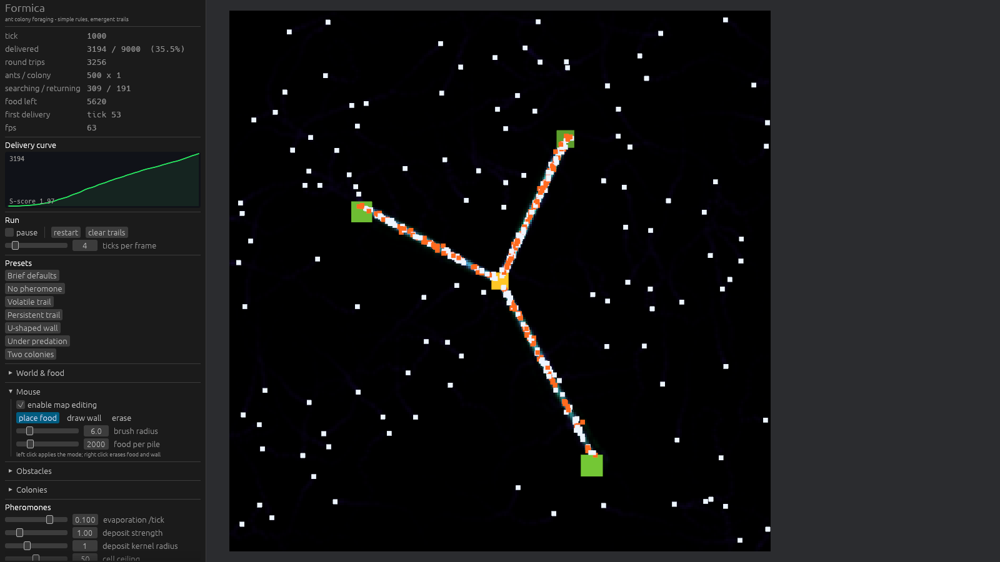

```
cargo run -p formica-headless --release -- --ticks 5000   # 命令行 + ASCII 曲线 + 参数扫描
cargo run -p formica-app     --release                    # 窗口 + 调参面板 + 鼠标改地图
```

游戏里能做的事：拖滑块实时调参、改地图尺寸、**鼠标点击放食物**、鼠标拖拽画墙、
开关捕食者、开第二窝蚂蚁竞争。命令行能跑同样的配置并给出数字。

---

## 目录

- [验收结果](#验收结果)
- [三处观感优化](#三处观感优化)
- [快速开始](#快速开始)
- [机制说明](#机制说明)
- [架构](#架构)
- [参数参考](#参数参考)
- [Phase 4 扩展特性](#phase-4-扩展特性)
- [实验与发现](#实验与发现)
- [项目结构](#项目结构)
- [测试](#测试)

---

## 验收结果

### Phase 1 验收标准

> 能在 5000 tick 内看到食物总量曲线呈 S 形增长

**通过。** 默认参数（500 只蚂蚁、256×256、蒸发率 0.1、感知半径 3、随机游走 0.3、速度 2 格/tick）
完整跑满 5000 tick：

```
9000 |                                        ######################################
     |                                   ###########################################
     |                               ###############################################
     |                            ##################################################
     |                         #####################################################
     |                       #######################################################
     |                     #########################################################
     |                   ###########################################################
     |                ##############################################################
     |              ################################################################
     |            ##################################################################
     |          ####################################################################
     |        ######################################################################
     |      ########################################################################
     |    ##########################################################################
   0 |##############################################################################
     +------------------------------------------------------------------------------
      tick 0                                                            tick 5000
```

| 指标 | 数值 |
|---|---|
| 运回食物总量 | 9000.0 / 9000.0 单位（**100%** 回收） |
| 往返次数 | 9207 次 |
| 首次运回 | tick 60 |
| 10% / 50% / 90% | tick 400 / 1360 / 2630 |
| 峰值运回速率 | tick 400 |
| **S 形评分** | **3.50** |

**"S 形评分"的定义**（`formica_core::metrics::analyze`）：

```
S 评分 = 峰值区间运回量 / 平均区间运回量
```

匀速直线累积的曲线，峰值等于均值，评分 1.0；S 形曲线有滞后期、陡增期、平台期，峰值远高于均值。
本项目采用的判定阈值：`>= 2.0` 强 S、`>= 1.5` 明显 S、`>= 1.15` 弱 S、其余视为线性。

曲线形态与里程碑完全吻合 S 形：前 400 tick 只运回 10%（滞后期），400→2630 tick 运回 80%（陡增期），
2630 tick 之后几乎水平（平台期）。

### Phase 2 验收标准

> 能直观看到路径从混沌到收敛的全过程

信息素场是单张 256×256 的 `Image` 资源，每帧重写 CPU 端字节缓冲后由 Bevy 重新上传，
以一张 sprite 铺满整张地图，GPU 最近邻采样渲染。蚂蚁/巢穴/食物堆是普通颜色 sprite。

**tick 1000**（`docs/phase2-converged.png`）：三条通路已经成形，从巢穴（琥珀色方块）分别通向左中、右上、
右下三个食物堆（绿色方块）。白色小点是觅食态蚂蚁，橙色小点是载着食物的归巢态蚂蚁。
紫蓝色弥散是归巢信息素，通路上的青绿色是食物信息素。


**tick 60**（`docs/phase2-early.png`）：同一次运行的早期。通路还只是刚出现的细线，
大部分蚂蚁仍在图上乱走——这就是"混沌"的起点。

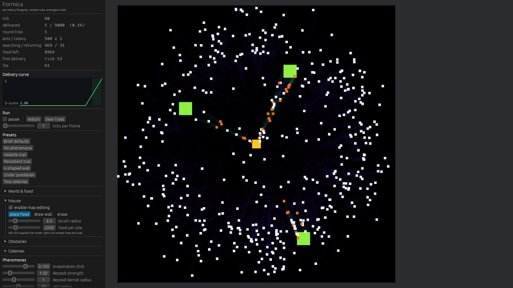

几张图连起来看，能直接读到正反馈在起作用。面板里的 `searching / returning` 读数：

| tick | 觅食态 / 归巢态 | 归巢占比 | 已运回 |
|---|---|---|---|
| 500 | 331 / 169 | 34% | 15.4% |
| 1500 | 362 / 138 | 28% | 55.9% |
| 3000 | 432 / 68 | 14% | 97.0% |

tick 500 前后归巢占比达到 34% 的峰值：通路一旦形成，就有更大比例的蚂蚁能找到食物并满载而归。
之后占比单调回落，是因为食物快被搬空了，没什么可运的。

### 自动截图（用于无人值守验证）

画面对不对，不能靠"看起来差不多"。窗口版支持环境变量驱动的脚本化运行，
`scripts/capture-figures.ps1` 就是用它把本文件里的每一张图重新生成一遍：

```bash
FORMICA_SCREENSHOT=docs/shot.png \
FORMICA_SCREENSHOT_FRAME=90 \
FORMICA_TICKS_PER_FRAME=4 \
FORMICA_EXIT_AFTER=115 \
cargo run -p formica-app --release
```

| 环境变量 | 作用 |
|---|---|
| `FORMICA_SCREENSHOT` | 截一帧写到该路径 |
| `FORMICA_SCREENSHOT_FRAME` | 第几帧截（默认 600） |
| `FORMICA_TICKS_PER_FRAME` | 启动时的快进倍率 |
| `FORMICA_EXIT_AFTER` | 第几帧退出 |
| `FORMICA_ANTS` / `FORMICA_COLONIES` / `FORMICA_MAP_SIZE` | 覆盖蚁群规模与地图 |
| `FORMICA_INDIVIDUALITY` | 覆盖个体差异强度（`0` = 全部一样的蚂蚁） |
| `FORMICA_OBSTACLES` / `FORMICA_BLOCK_DENSITY` / `FORMICA_U_WALL_GAP` | 覆盖障碍物 |
| `FORMICA_CROWD_THRESHOLD` / `FORMICA_CROWD_RELIEF` | 覆盖拥挤缓解参数 |
| `FORMICA_SHOW_FOOD` / `FORMICA_SHOW_HOME` | 置 `0` 隐藏对应信息素 |
| `FORMICA_FOOD_GAIN` / `FORMICA_HOME_GAIN` | 覆盖显示增益 |

这套开关是用来**验证**配色断言的，不是装饰。对渲染出的 PNG 做逐像素统计（`scripts` 里没有这一步，
是临时脚本；统计范围是地图那 580×580 像素）：
`FORMICA_SHOW_HOME=0` 的那一帧里有 **2255 个绿色主导像素、0 个紫色主导像素**——
这才确认了"食物信息素是绿的"在屏幕上真的成立，而不是只在我的映射公式里成立。

### Phase 3 验收标准

> 拖动滑块能实时看到路径形态变化

所有滑块直接写进 `SimConfig` 这个 `Resource`，而**每一个仿真 system 每 tick 都重新读取它**。
所谓"热更新"不是额外实现的功能，而是数据导向设计的自然结果——面板里没有任何 Apply 按钮。

蚁群数量、蚁群窝数、墙、捕食者都是**运行时**生效的：`sync_ant_count` / `sync_nests` /
`sync_obstacles` / `sync_predator_count` 各自把世界拉回配置描述的样子。唯一需要按钮的是地图尺寸。

### Phase 4 验收标准（可选特性）

> 障碍物（U 形墙）、捕食者、双蚁群竞争

三个都实现了，**每个都有对照实验和量化结果**——详见 [Phase 4 扩展特性](#phase-4-扩展特性)：

| 特性 | 对照结果 |
|---|---|
| U 形墙 | 6761 → **5638**（−16.6%），且蚁群仍能找到绕行路线 |
| 捕食者（8 只） | 7887 → **2550**（−67.7%）；蚂蚁数量不缩水，代价是时间和货物 |
| 双蚁群 | 一窝 150 只 6161 → 两窝各 75 只 6104（同一巢区、四个种子的平均代价约 **3%**） |

---

## 三处观感优化

项目跑通之后提了三条改进意见。三条都不是"调个参数"，因为三条各有各的根因，而且
**每一条都先复现、再量化、最后才动代码**——写下这些数字是为了让"改好了"可被反驳。

### 1. "初始状态蚂蚁直接圆形扩散不合理"

**复现**：默认参数跑到第 4 帧，500 只蚂蚁是一个**完美的空心圆环**：一圈白点，中间是空的巢穴。

**根因**：这不是参数问题，是**对称性**问题，任何参数都改不掉。
每只蚂蚁的规则完全一样，出生时朝向都是"背对巢穴"，速度也都是 2 格/tick，
于是整群蚂蚁在同一时刻出现在同一半径上——一个均匀的圆盘就这样变成了一圈薄壳。
对一群**完全相同**的随机游走者做系综平均，结果必然是径向对称的。

**修法**：给每只蚂蚁一份**个体差异**（`AntVigor`）。从同一个对数正态分布里取一个"胆量"值，
同时乘在它的随机游走强度和速度上：约 2% 是近乎直线的远行者，约 2% 是几乎不离巢的"宅蚁"，
其余在中间。另外出生朝向不再是精确的径向，而是加了 ±1 弧度的偏移。

| tick 30，200×200，400 只蚂蚁 | 最外 1/5 半径内的蚂蚁占比 | 内侧 40% 半径内 |
|---|---|---|
| `individuality = 0.0`（全部一样） | **66%** | **0.2%**（中间是空的） |
| `individuality = 0.6`（默认） | **14%** | **5.0%** |

同一个对比在 tick 20 和 tick 45 分别是 65%/17% 和 63%/10%，所以结论不依赖于某一帧。

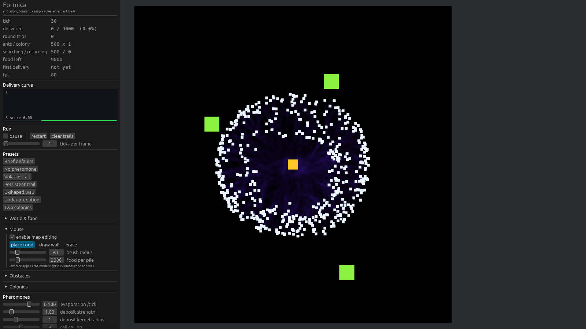

*`FORMICA_INDIVIDUALITY=0`：教科书式的空心圆环。*

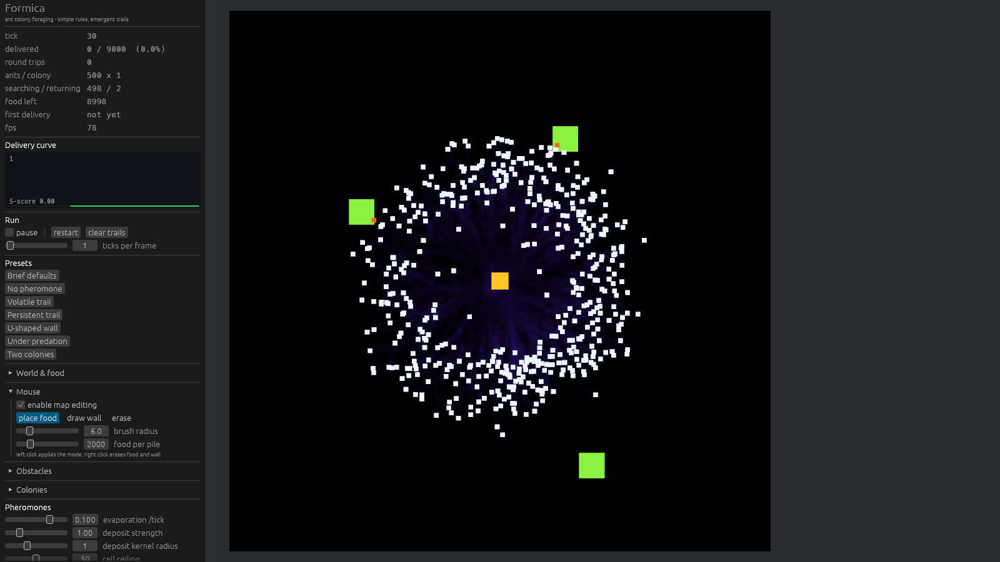

*默认参数同一时刻：圆环被打散成不规则的团块与丝状通道。*

**一个必须说清楚的界限**：圆环是一个**瞬态**，不是稳态。在 200 格的地图上跑到 tick 600，
连完全一样的蚂蚁也早就撞到边墙弹回来、混匀了，那时的径向分布看不出任何区别——
我第一版测试就是在 tick 600 写的，于是它什么都没测出来（见[发现 10](#10-一个在错误的时刻测量的测试)）。
tick 30 才是这条意见真正在说的东西。

### 2. "经过搬运之后食物尺寸可以缩小"

**复现**：查代码发现**这个功能已经存在**了——`sync_food_sprites` 按剩余量缩放 sprite。
真正的问题在截图里：被搬空的堆会缩到 30% 并**变成红色**留在图上。

- **红色是捕食者的颜色**。一个空食物堆看起来像威胁。
- **30% 的下限意味着它永不消失**。而 `FoodField::piles` 会保留吃空的堆（玩家还要靠它来擦除），
  所以跑满一局之后地图上会积一堆永远在那儿的彩色小方块。

**修法**：半径改成 `sqrt(剩余比例)`（一堆食物摊成一片圆盘，面积正比于质量，所以半径正比于根号），
去掉下限；配色从"绿→红"改成**绿→暗绿**；剩余低于 0.5% 直接不绘制。

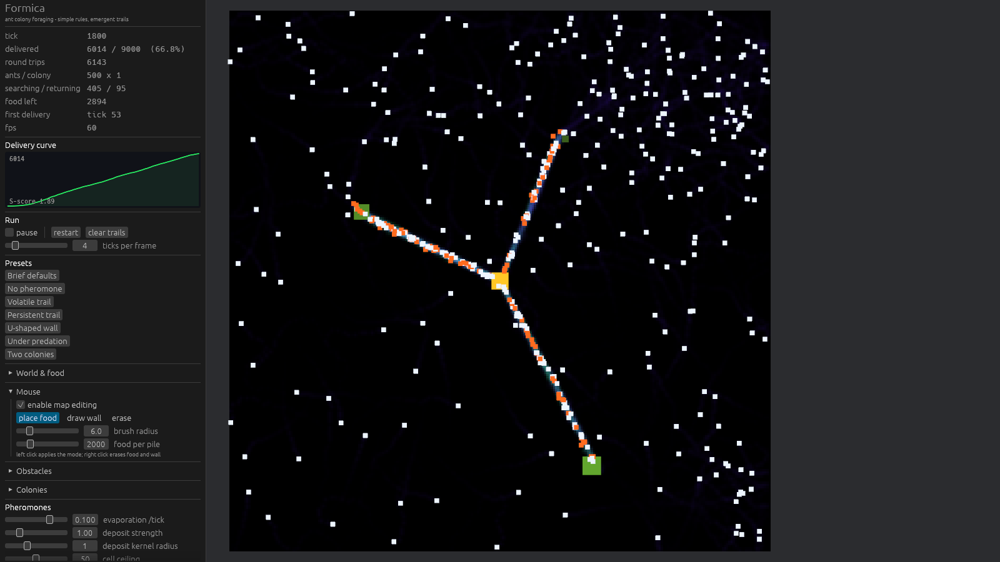

*tick 1800：三个食物堆尺寸明显不同，右上那堆已被搬空一半以上，左下那堆还基本没动。*

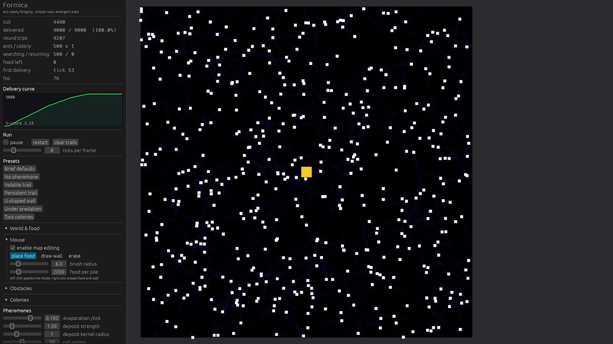

*tick 4480：9000/9000 全部运回，三个食物堆彻底消失，地图上没有残留的色块。*

### 3. "有障碍物且蚂蚁不易到达时，蚂蚁会全部聚集到一个点上"

**复现**：这句话是三条里最难复现的。U 形墙、默认密度的随机方块墙都测不出聚集——
它们只让蚂蚁排队，不会让它们塌成一个点。真正复现它的是**高密度迷宫**：
45% 的格子是墙时，500 只蚂蚁里有 **121 只**站在同一个 4×4 的方块上（16 格），
整局只运回 599/9000。

**根因**：队列无处可去。系统里没有任何一只蚂蚁知道"这一格上已经有二十只同伴了"。
`sense → decide → move → deposit` 每一步都完全按规格执行；缺的是一条**物理**规则。

**修法**：加两个 system。`tally_crowding` 每 tick 把蚂蚁数进一张 4×4 的粗粒度网格；
`relieve_crowding` 让站在过密格里的蚂蚁朝**最空的邻格**挪一小步（默认 0.6 格/tick），
并且只在挪过去不是墙、且挪完之后朝向跟着改的时候才挪。

阈值是**软的**：越界越多推得越多。因为两种情形必须共存——
空旷地图上一条繁忙通路的峰值是每格 28 只，而迷宫里的**平均值**就是 55。
硬阈值必须卡在中间，于是要么抓不住真正的堵塞，要么把健康的通路也推乱。

| 墙密度（256×256，500 只，3000 tick） | 峰值格子（关） | 峰值格子（开） | 平均（关） | 平均（开） | 运回（关） | 运回（开） |
|---|---|---|---|---|---|---|
| 0.15 | 46 | **31** | 17.5 | 14.1 | 6362 | **6784**（+6.6%） |
| 0.25 | 78 | **30** | 29.8 | 16.2 | 4653 | **4770**（+2.5%） |
| 0.35 | 62 | **29** | 39.4 | 16.1 | 1854 | **2165**（+16.8%） |
| 0.45 | **121** | **30** | 55.1 | 15.9 | 599 | **696**（+16.2%） |

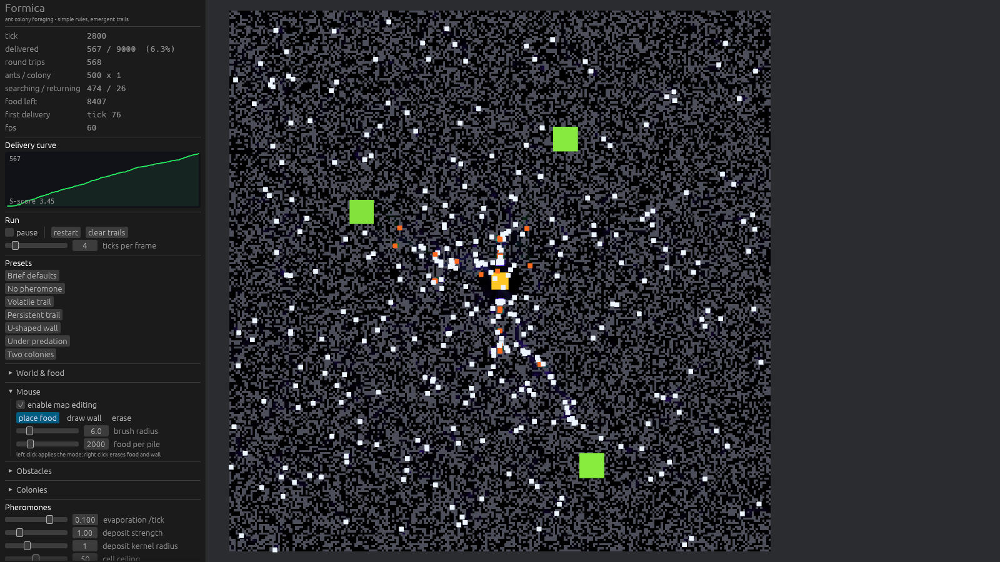

*关掉缓解（`FORMICA_CROWD_RELIEF=0`）：巢穴下方糊成一团，通路只是几段短桩。*

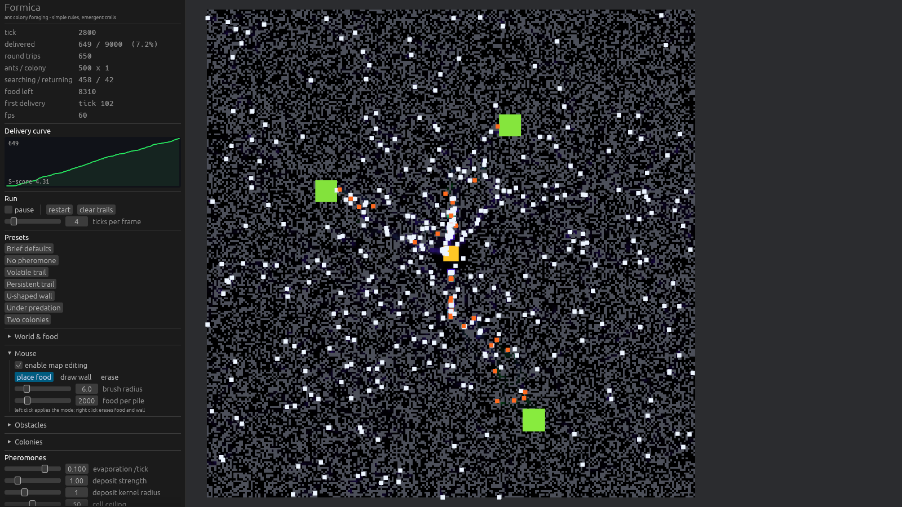

*开启缓解：同样的种子与参数，蚂蚁摊开，通路从巢穴一直连到右下角的食物堆。*

**诚实的边界**：45% 密度下，可通行格子占 55%，而方格点渗流阈值是 **0.593**——
也就是说地形本身**不渗流**，空地碎成一个个有限的口袋，蚂蚁根本出不去。
拥挤缓解能让它们在口袋里摊开（峰值 121 → 30，产量 +16%），
但不能让它们越狱。这部分不是拥挤规则的问题，是地形的问题，
所以上表里给的分档能直接看出"哪一段是缓解能救的、哪一段不能"。

---

## 快速开始

需要 Rust 1.95+（本项目在 1.97.1 上验证）。首次编译 Bevy 需要几分钟。

### Phase 1：无渲染命令行

```bash
# 默认参数跑 5000 tick，打印 ASCII 曲线和完整报告
cargo run -p formica-headless --release -- --ticks 5000

# 把曲线导出成 CSV（tick, delivered, colony0, colony1, searching, returning, ...）
cargo run -p formica-headless --release -- --ticks 5000 --csv docs/curve.csv

# 参数扫描：一次跑多组并对比
cargo run -p formica-headless --release -- --sweep-evaporation 0.005,0.01,0.05,0.1,0.2,0.3
cargo run -p formica-headless --release -- --sweep-random-walk 0.0,0.1,0.3,0.6,1.0
cargo run -p formica-headless --release -- --sweep-predators 0,1,2,4,8
cargo run -p formica-headless --release -- --sweep-individuality 0.0,0.2,0.4,0.6,1.0,1.5

# 单独开一个特性
cargo run -p formica-headless --release -- --obstacles u-wall --ticks 2500
cargo run -p formica-headless --release -- --predators 6 --food-per-pile 4000
cargo run -p formica-headless --release -- --colonies 2 --ants 250

# 全部选项
cargo run -p formica-headless --release -- --help
```

命令行退出码：运回了食物 → `0`，一只都没运回 → `1`。可以直接用作 CI 检查。

### Phase 2 + 3 + 4：可交互窗口

```bash
cargo run -p formica-app --release
```

**鼠标操作**（面板 `Mouse` 区可切换模式和开关）：

| 操作 | 效果 |
|---|---|
| 左键点击地图 | 按当前模式放食物 / 画墙 / 擦除 |
| 左键拖动 | 连续画墙（食物只在按下瞬间放一堆，否则食物量会变成帧率的函数） |
| 右键点击或拖动 | 擦除：移走鼠标下的食物堆，并清掉刷子范围内的墙 |

左侧面板：

| 分区 | 内容 |
|---|---|
| 运行状态 | tick、运回量、**分窝统计**、往返次数、觅食/归巢数量、蚂蚁被吃数、FPS |
| 运回曲线 | 实时绘制的累积曲线（**两窝时画两条**）+ S 评分 |
| Run | 暂停、restart、**清空信息素**、ticks/frame 快进 |
| Presets | 七组可复现的对比参数 |
| World & food | **地图尺寸（拖完点 apply size）**、食物堆数量 / 总量 / 半径 |
| Mouse | 地图编辑开关、模式、刷子半径、新食物堆含多少食物 |
| Obstacles | 空地 / U 形墙 / 随机方块；U 形墙尺寸、方块密度 |
| Colonies | **蚁群数量 1–2**、两巢间距 |
| Pheromones | 蒸发率（对数滑块）、撒放强度、撒放核半径、浓度上限 |
| Ants | 每窝蚂蚁数、速度、感知半径、触角张角、采样半径、随机游走、循迹增益、归巢气味引导、**个体差异** |
| Crowding | **堵塞阈值、缓解步长**，以及实时的"最挤的 4×4 方块里有多少只蚂蚁"读数 |
| Predators | **捕食者数量**、速度、视野、捕获半径、游走强度 |
| Display | 食物/归巢信息素增益、显隐 |

地图尺寸之所以要按一次按钮而不是即时生效：改尺寸要重新分配信息素纹理并重建整个场景，
跟着滑块每像素重建一次没法用。其余参数都是即时生效的。

### 测试

```bash
cargo test --release                                            # 185 个单元 + 集成测试
cargo test -p formica-core --release -- --ignored --nocapture   # 完整 5000 tick 验收（会打印曲线）
```

---

## 机制说明

### 为什么要"两种"信息素

这是整个项目最容易搞错的地方。如果只用一个信息素场，会发生一件致命的事：
**归巢蚂蚁留下的气味指向巢穴，觅食蚂蚁顺着它走，就会一路走回巢穴。**

两种独立的信息素把"气味"变成有方向的信号：

| 状态 | 行为 | 撒放 | 跟随 |
|---|---|---|---|
| **觅食态** (Searching) | 随机游走 + 偏向食物信息素 | 归巢信息素 | 食物信息素 |
| **归巢态** (Returning) | 朝巢穴方向前进 | 食物信息素 | 归巢信息素* |

\* 归巢蚂蚁默认**直接朝巢穴走**，不跟气味（这是任务书的明确要求）。`home_pheromone_weight` 滑块可以把
归巢信息素混进转向，默认 0.0 即任务书行为——留作 Phase 4 的实验开关。

关键在于：**没有任何一只蚂蚁会去写它自己正在跟随的那个场**。
食物信息素只有满载而归的蚂蚁才撒，所以它天然标出"食物在这个方向"；归巢信息素只有还在找食物的蚂蚁才撒，
所以它天然标出"巢穴在这个方向"。信息的方向性不是设计出来的，是**状态与动作的对应关系**推出来的。

### 为什么它会收敛

单只蚂蚁的行为里没有任何收敛机制：它只是"闻哪边浓就往哪边偏一点"。收敛来自正反馈：

1. 一只蚂蚁**碰巧**找到食物，满载而归，一路上撒下食物信息素。
2. 更多觅食蚂蚁闻到这条痕迹，偏向它 → 更大概率也走到食物。
3. 它们也满载而归，走同一条路，把痕迹加得更浓。
4. 浓痕迹吸引更多蚂蚁 —— 通路被"锁"住了。

这个正反馈的另一面是**蒸发**。蒸发让没人走的痕迹消失，所以废弃的食物堆对应的通路会自动断掉。
没有蒸发，所有格子都会饱和到上限，梯度消失，蚂蚁就变成了瞎子。**沉积与蒸发是一对平衡**，缺一不可。

### 为什么蚂蚁不是一模一样的

单只蚂蚁的规则里没有随机性以外的东西，但**每只蚂蚁的随机性大小不同**。
`AntVigor` 从对数正态分布里抽一个"胆量"，同时乘在游走强度和速度上。

这不是为了好看。一群**规则完全相同**的蚂蚁，行为在统计上就是径向对称的：
它们同时离开巢穴、速度相同、朝向都是背对巢穴，于是种群在几何上必然是一个不断扩大的圆环。
这跟参数取值无关——是系综平均的数学结论。要打破它，唯一的方法是**个体之间要有差异**。

真实蚁群本来就是这样：少数侦察蚁跑得又快又远、几乎走直线，
多数工蚁在巢附近磨蹭。默认参数下大约 2% 是前者、2% 是后者。
代价是稀疏蚁群里的产量（见[发现 4](#4-个体差异扫描来得更快稀疏时搬得更少)），
收益是蚁群提前 ~28% 找到第一口食物，而且扩散的形状不再是一个圆。

### 三个触角而不是一个梯度

蚂蚁不是"朝着浓度最高的方向爬"。它在前方 3 个点（左 `-sensor_angle`、正前、右 `+sensor_angle`）
各采样一次，然后**转向读数最大的那一边**。

这个区别很重要：梯度爬升只能告诉蚂蚁"往浓度高的地方走"，但一条浓度大致均匀的路径上是没有梯度的。
三点采样做的是**循迹对齐**——已经沿着路走的蚂蚁，两侧读数相等，会继续直行；
斜着撞上路面的蚂蚁，会转向与路对齐。这正是真实蚂蚁用触角做的事。

采样时对每个触角点做一个 `(2r+1)²` 的**盒平均**而不是点采样。因为蚂蚁每 tick 走 2 格，
点采样会让它一步跨过自己留下的单格痕迹，读数全是噪声。

---

## 架构

### 数据导向设计

任务书要求"蚂蚁数据用 Component 存储，不用单独的 struct Vec"。所以蚂蚁不是 `Vec<Ant>`，而是**八个独立 Component**：

| Component | 含义 | 谁写 |
|---|---|---|
| `AntMarker` | 标记 | — |
| `AntColony(usize)` | 属于哪一窝：决定读写哪套信息素场、回哪个巢 | 生成时固定 |
| `AntPos { x, y }` | 连续坐标 | `move_ants`, `relieve_crowding` |
| `AntHeading { angle }` | 朝向（弧度） | `decide_heading`, `move_ants`, `relieve_crowding` |
| `AntState` | 状态机：`Searching` / `Returning` | `pickup_food`, `deliver_food` |
| `Carrying { amount }` | 携带量 | `pickup_food`, `deliver_food` |
| `PheromoneSensors { left, center, right }` | 三个触角读数 | `sense_pheromones` |
| `AntVigor { wander, speed }` | **个体差异**：这只蚂蚁自己的游走强度与速度倍率 | 生成时固定，永不改变 |

`AntVigor` 是整份代码里唯一的"个体性"，也是唯一一个**只在生成时写一次、之后再不改动**的 Component。
它存在的理由见[三处观感优化 #1](#1-初始状态蚂蚁直接圆形扩散不合理)：没有它，
一群规则相同的蚂蚁在数学上必然是径向对称的。

捕食者同样拆成四个 Component（`PredatorMarker` / `PredatorPos` / `PredatorHeading` / `PredatorAlert`）。

资源（`Resource`）：

| Resource | 内容 |
|---|---|
| `SimConfig` | 全部可调参数 |
| `PheromoneGrid` | **每窝两个** `f32` 场，装在一个扁平 `Vec` 里（`256×256×2 窝×2 通道`） |
| `Obstacles` | 每格是否墙 + 形状版本号 |
| `FoodField` | 每格食物量 + 堆信息 + 总量账目（含玩家删除量） |
| `Nests` | 每窝巢穴的位置与半径 |
| `CrowdGrid` | 4×4 粗粒度蚂蚁计数 + 峰值 + 被占用的方块数（诊断与拥挤缓解共用） |
| `SimRng` | SplitMix64 确定性随机数 |
| `SimStats` | 统计、**分窝账目**、运回曲线、浓度读数 |

两个设计细节值得单独说：

- **`PheromoneGrid` 永远按最大窝数分配**。窝数是可以运行时改的，如果按当前窝数分配，
  玩家一开第二窝，1 号窝的索引就会被夹到 0 号窝的场上——两窝开始**共享同一套气味**，
  而且什么都不会报错。多出来的场每张 256 KiB，代价是一条稍长的蒸发扫描。
- **`Carrying.amount` 是 `f32`，累计账目是 `f64`**。前者读一次就丢，后者要跨几万 tick 累加。

### System 拆分

任务书要求 sense / decide / move / deposit / evaporate 分开写。实际拆成 **16 个 system**，
串在一个**独立的 `SimulationTick` schedule** 里：

```
sync_nests              窝数变了就重建巢穴（否则两窝会挤在同一个巢）
      ↓
sync_obstacles          按预设重新铺墙（几何参数写在预设里，所以拖滑块会自动重建）
      ↓
scrub_obstacle_pheromones  墙下的信息素清零
      ↓
sync_predator_count     捕食者数量跟上配置
      ↓
evaporate_pheromones    c *= (1 - rate)，所有窝一次扫完
      ↓
sense_pheromones        三个触角 → PheromoneSensors（只读自己那窝）
      ↓
decide_heading          sensors + 个体噪声 + 回自己的巢 → AntHeading
      ↓
move_ants               AntHeading × 个体速度 → AntPos（边界反射 + 绕墙滑行）
      ↓
move_predators          追最近的蚂蚁，追不到就游走
      ↓
tally_crowding          蚂蚁坐标 → 4×4 粗粒度密度网格
      ↓
relieve_crowding        站在过密格子里的蚂蚁朝最空的邻格挪一小步
      ↓
deposit_pheromones      AntPos + state → 自己那窝的场（撒放核也要绕开墙）
      ↓
pickup_food             踩到食物 → Carrying, state := Returning
      ↓
deliver_food            回到**自己的**巢穴 → 记在自己那窝账上, state := Searching
      ↓
predators_catch_ants    吃掉够近的蚂蚁（巢内免疫）
      ↓
sync_ant_count          把被吃的补回来——放在捕食之后，所以 tick 边界上数量精确
      ↓
update_stats            计数 + 记录曲线点
```

两个拥挤 system 夹在移动和撒放之间，位置是刻意的：`tally_crowding` 必须看到本 tick 的最终位置，
而 `relieve_crowding` 必须在撒放之前落地，这样被挤开的蚂蚁才会按**它实际站的位置**留下气味。

**为什么用独立 schedule 而不是 `Update` / `FixedUpdate`**：这个 schedule 引擎**永远不会自己跑**。
命令行版直接 `world.run_schedule(SimulationTick)` × N，零引擎开销、与真实时间完全无关；
窗口版在 `Update` 里跑 N 次，所以"快进"只是一个计数器，而不是另一套物理。
两条路径跑的是**同一批 system、同一个顺序**——Phase 1 测出来的数字就是对 Phase 2 画面的预测。

### 依赖

`formica-core` 只依赖 `bevy_ecs` + `bevy_app`，**不依赖渲染**。所以 Phase 1 的验收运行不需要 GPU、
不需要窗口、可以跑在 CI 里。`formica-app` 才引入完整 Bevy（只开 `2d` + `ui` feature，不含 3D 与音频）。

版本：**Bevy 0.19.1** + **bevy_egui 0.42.0**（egui 0.36）。

---

## 参数参考

| 参数 | 默认值 | 命令行 | 说明 |
|---|---|---|---|
| `ant_count` | 500 | `--ants` | **每窝**蚂蚁数（两窝时总数翻倍） |
| `colony_count` | 1 | `--colonies` | 竞争蚁群数量，1–2 |
| `nest_orbit` | 55 | `--nest-orbit` | 两窝时巢穴到地图中心的距离 |
| `width` × `height` | 256×256 | `--width/--height` | 地图尺寸 |
| `evaporation_rate` | 0.1 | `--evaporation` | 每 tick `c *= (1 - r)` |
| `sensor_distance` | 3.0 | `--sensor-distance` | 感知半径（格） |
| `sensor_angle` | 0.6 | `--sensor-angle` | 触角半张角（弧度） |
| `sensor_box_radius` | 1 | `--sensor-box` | 触角盒平均半径 |
| `random_walk_strength` | 0.3 | `--random-walk` | 每 tick 朝向抖动 |
| `speed` | 2.0 | `--speed` | 每 tick 移动格数 |
| `deposit_amount` | 1.0 | `--deposit` | 每只蚂蚁每 tick 撒放总量 |
| `deposit_radius` | 1 | `--deposit-radius` | 撒放核半径（总量守恒） |
| `sensor_turn_gain` | 0.6 | `--turn-gain` | 朝最优触角的转向量 |
| `max_turn_rate` | 0.8 | — | 归巢时每 tick 最大转向 |
| `home_pheromone_weight` | 0.0 | — | 归巢蚂蚁跟随归巢气味的权重（0 = 任务书行为） |
| `individuality` | 0.6 | `--individuality` | **个体差异强度**（对数正态 sigma，0 = 全部一样） |
| `crowd_threshold` | 24 | `--crowd-threshold` | 每个 4×4 方块超过多少只算堵塞 |
| `crowd_relief` | 0.6 | `--crowd-relief` | 挤开时每 tick 挪多少格（0 = 关闭缓解） |
| `food_pile_count` | 3 | `--piles` | 食物堆数量（1–8） |
| `food_per_pile` | 3000 | `--food-per-pile` | 每堆食物量 |
| `food_pile_radius` | 6.0 | `--pile-radius` | 堆半径（格） |
| `ant_capacity` | 1.0 | — | 单只蚂蚁载重 |
| `obstacle_preset` | None | `--obstacles` | `none` / `u-wall` / `blocks` |
| `predator_count` | 0 | `--predators` | 捕食者数量，0 = 关闭 |
| `predator_speed` | 1.6 | `--predator-speed` | 捕食者速度（格/tick） |
| `predator_sense` | 26 | `--predator-sense` | 捕食者视野半径（格） |
| `predator_catch_radius` | 3 | `--predator-catch` | 捕获半径（格） |
| `max_pheromone` | 50.0 | — | 单格浓度上限 |
| `seed` | 20240517 | `--seed` | 随机种子（同种子 = 逐位相同的运行） |

---

## Phase 4 扩展特性

三个可选特性都实现了，而且都**能量化**——每一条都有对照实验，不是"看起来能用"。

### 1. 障碍物（U 形墙）

墙是一张按格的布尔表（`Obstacles`，一个 `Resource`）。蚂蚁不能进入墙格、不能在墙里撒信息素、
墙下的信息素会被清掉。墙直接画进信息素纹理里，所以不占额外 draw call，也不可能和模拟实际阻挡的格子错位。

U 形墙预设会把**第一个食物堆**包起来，开口背对巢穴、实心背面朝向巢穴，
所以蚂蚁直着走出去会撞墙，必须绕路。

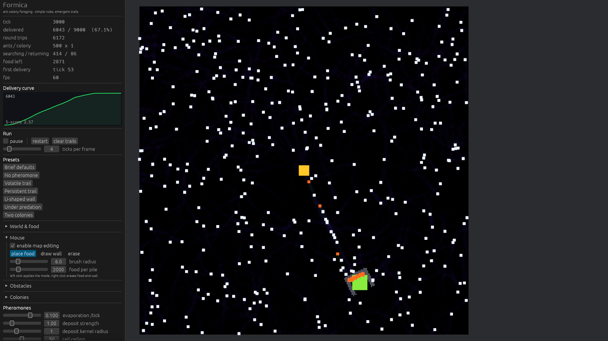

上图 tick 3000：食物堆之一被 U 形墙围住，蚁群仍然搬到了它，但代价肉眼可见——
通路必须绕到墙的开口，直达的那条直线不存在。

| 配置（96×96，2500 tick） | 运回量 | 回收率 | 墙格数 |
|---|---|---|---|
| 空地 | 6761 | 56.5% | 0 |
| U 形墙 | **5638（−16.6%）** | 47.2% | 126（0.2%） |

值得一看的是**过程**而不是数字：第一批到达的蚂蚁是碰巧绕过去的那批，
存活下来的通路是绕过去的那条，而那条撞死在墙上的直线通路会自己蒸发掉。
这就是"错误路径被淘汰"的直接演示。

### 2. 捕食者

捕食者只有两条规则：看得见蚂蚁就朝最近的冲，看不见就随机游走。
它们没有信息素、没有状态机、没有记忆。

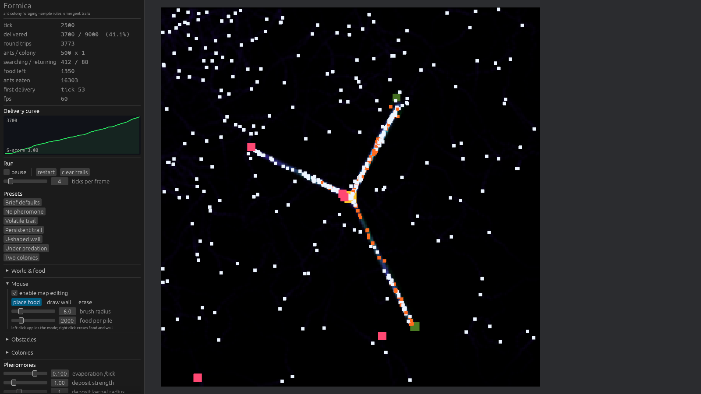

**被吃掉的蚂蚁不是永久损失**：`sync_ant_count` 在 `predators_catch_ants` 之后运行，
所以每个受害者都在同一个 tick 内被补回巢穴。捕食的代价是**时间和货物**，不是命。
这样"有捕食者"和"没捕食者"两组才是可比的。

**巢穴是避难所**：巢内的蚂蚁免疫。没有这条规则，跟着气味摸到巢穴的捕食者会蹲在巢口，
把每一只刚重生的蚂蚁当场吃掉——那不是捕食，那是黑洞。

| 捕食者数量（256×256，2500 tick） | 运回量 | 回收率 | S 评分 | 被吃 |
|---|---|---|---|---|
| 0 | 7887 | 87.6% | 2.00 | 0 |
| 1 | 7250 | 80.5% | 2.18 | 2141 |
| 2 | 7266 | 80.7% | 1.92 | 2343 |
| 4 | 4473 | 49.7% | 2.78 | 11795 |
| 8 | **2550** | **28.3%** | **3.74** | 25571 |

8 只捕食者把产量压到三分之一。注意 S 评分随捕食压力**单调上升**（2.00 → 3.74）：
曲线前半段几乎趴平，因为蚁群要花很久才凑出足够多的工蚁把通路撑起来，
滞后相被拉长，峰值/均值之比自然变大。

### 3. 双蚁群竞争

两窝蚂蚁**各有各的信息素场**（`PheromoneGrid` 里每窝存 food/home 两个场）、**各有各的巢穴**，
但**共享同一批有限食物**。一窝闻不到另一窝的气味——这正是"合作"和"竞争"的分界线。

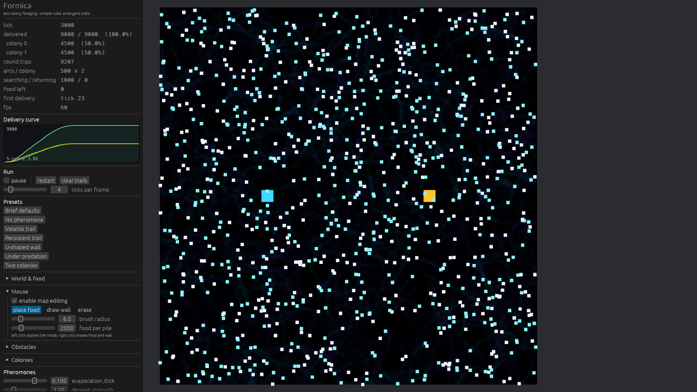

上图 tick 3000：右巢（琥珀色）是 0 号窝，左巢（青色）是 1 号窝。
**两条通路互不合并**——同一张地图，两套互不可见的信息体系。
这一局两窝各运回 4500，正好 50.0% / 50.0%，地图被搬空。

**"分家要付多少代价"这个问题，现在的答案比原来复杂。**
原来的对照是"一窝 300 只 vs 两窝各 150 只"，量出 −11.8%。加上个体差异之后再测，
这个对比**不再稳健**：四个种子上的差距是 +1.4%、+12.2%、−5.6%、+8.7%，
符号都能反过来。原因有两个，都是量出来的：

- 第二窝不只是"劈开的气味预算"，它还是**第二个搜索起点**。在默认的 110 格巢距下，
  两窝的覆盖优势超过了气味劣势。
- 个体差异让每窝**自己就更会探索**，于是"缺了共享痕迹"这件事没那么致命。

把两个巢穴挪到相距 24 格（`--nest-orbit 12`）消除覆盖优势之后，符号就稳定了：

| 种子 | 一窝 150 只 | 两窝各 75 只 | 差距 |
|---|---|---|---|
| 20240517 | 6161 | 6104 | +0.9% |
| 1 | 5953 | 5844 | +1.8% |
| 7 | 5882 | 5624 | +4.4% |
| 99 | 6019 | 5719 | +5.0% |

四个种子上**全部为负**，平均约 **3%**。测试断言的正是这个：
`two_colonies_do_not_share_trails` 跑四个种子，要求每个种子都亏、平均值超过 1.5%。

一个诚实的说明：两窝的巢穴在地图中心两侧对称放置，到**地图中心**等距，
但食物是按种子随机撒在一个环上的，所以**单个种子上两窝并不完全公平**。
分窝读数就是为了让这种不对称可见，而不是被总量掩盖。

### 4. 全开

三个特性互不冲突，可以同时开：

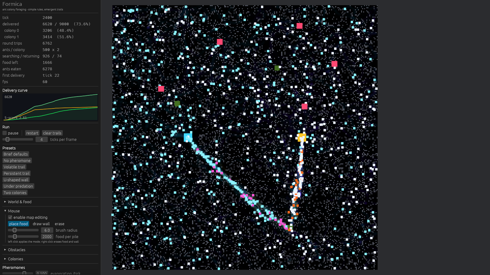

256×256 地图、随机方块墙（密度 0.15）、两窝蚂蚁各 500 只、5 只捕食者，tick 2400。
四条信息素通道同时渲染：0 号窝绿/紫、1 号窝琥珀/青，白/橙与青/品红分别是两窝的蚂蚁，
红色方块是捕食者，灰色格子是墙。面板里两窝的曲线分开画。

---

## 实验与发现

### 1. 对照实验：信息素到底有没有用？

只跑一次默认参数，看到一条 S 形曲线，**并不能证明 S 形是信息素造成的**。
所以我做了一个对照实验：两组参数完全一样、种子相同，唯一区别是第二组把
`deposit_amount = 0` 且 `sensor_turn_gain = 0`（纯随机游走，完全不用信息素）。

规模：128×128、150 只蚂蚁、3 堆 × 2000 单位、跑 4000 tick。

| | 运回总量 | 50% 里程碑 | S 评分 |
|---|---|---|---|
| **有信息素** | **6000**（全部） | **tick 1510** | 2.37 |
| 无信息素 | 2688 | tick 2050 | 2.68 |

信息素组多运回 **2.23 倍**的食物，并且提前 **540 tick** 达到一半。

**但是这里有个诚实的意外**：无信息素组的 S 评分是 **2.68**，反而比有信息素组更高，
也远超 1.5 的"S 形"阈值。我原本假设"没有信息素就应该是线性的"，代码证明我错了。

原因不难理解：蚂蚁全部从巢穴出发，一开始挤成一团，随着时间推移不断向外扩散，
**每 tick 覆盖的新面积在增加**，所以连纯随机游走找到食物的速率本身也是加速的。

结论：`sigmoid_score` 度量的是"是否在加速"，**不是**"是否自组织"。
要证明信息素在起作用，必须看**对照**（运回总量、t50），而不是看单条曲线的 S 评分。
这条已经写进 `metrics.rs` 的文档注释和集成测试里，避免以后被误读。

### 2. 蒸发率扫描：一个反直觉的结果

```bash
cargo run -p formica-headless --release -- --sweep-evaporation 0.005,0.01,0.03,0.05,0.1,0.2,0.3
```

**默认规模（500 只蚂蚁、3 堆 × 3000、5000 tick）——蒸发率几乎不影响结果：**

| 蒸发率 | 运回量 | 回收率 | S 评分 | 首达 tick | 曲线 |
|---|---|---|---|---|---|
| 0.005 | 9000.0 | 100.0% | 3.90 | 53 | `___.--==+***###@@@@@@@@@@@@@@@@@@@` |
| 0.010 | 9000.0 | 100.0% | 3.88 | 53 | `___.--==++*###@@@@@@@@@@@@@@@@@@@@` |
| 0.030 | 9000.0 | 100.0% | 3.64 | 53 | `___.--==++***###@@@@@@@@@@@@@@@@@@` |
| 0.050 | 9000.0 | 100.0% | 3.67 | 53 | `___.--==++**####@@@@@@@@@@@@@@@@@@` |
| **0.100（默认）** | 9000.0 | 100.0% | 3.50 | 53 | `___..--==+++***####@@@@@@@@@@@@@@@` |
| 0.200 | 9000.0 | 100.0% | 3.17 | 53 | `___..---===++***####@@@@@@@@@@@@@@` |
| 0.300 | 8848.3 | **98.3%** | 2.55 | 53 | `___...--===+++******########@@@@@@` |

0.005 到 0.3 跨了 **60 倍**，回收率几乎不动（只有 0.3 掉了 1.7%）。原因：500 只蚂蚁走同一条路时，
痕迹被补充的速度远快于衰减的速度，即使 `0.3/tick`（半衰期约 2 tick）也压不住。

**但把蚁群缩小到 60 只，蒸发率立刻变成决定性参数：**

```bash
cargo run -p formica-headless --release -- --sweep-evaporation 0.005,0.01,0.02,0.05,0.1,0.2,0.3 \
    --ants 60 --ticks 8000 --food-per-pile 2500
```

| 蒸发率 | 运回量 | 回收率 | S 评分 | 曲线 |
|---|---|---|---|---|
| 0.005 | 4430.7 | **59.1%** | 2.17 | `____....----====+++++*****#####@@@` |
| 0.010 | 4285.2 | 57.1% | 2.80 | `____.....----====+++++****#####@@@` |
| 0.020 | 3780.3 | 50.4% | 2.33 | `___....-----====+++++*****#####@@@` |
| 0.050 | 3112.1 | 41.5% | 3.08 | `___.....-----====++++******####@@@` |
| **0.100（默认）** | 2842.8 | 37.9% | 2.81 | `____....-----=====++++****#####@@@` |
| 0.200 | 1967.2 | 26.2% | 3.25 | `____.....---====+++******######@@@` |
| 0.300 | 659.0 | **8.8%** | 4.86 | `___....-----=====+++++*****#####@@` |

出现了清晰的单调权衡：

- **蒸发率低 → 产量高**：痕迹持久，蚁群能稳定复用已知通路，把食物搬空。
  代价是**探索能力差**——通路一旦定型就"僵化"，即使旁边还有食物也发现不了。
- **蒸发率高 → 产量低但 S 评分高**：滞后相被拉长（前期几乎找不到路），
  之后才出现陡增。0.3 时蚁群基本失效，只回收 8.8%。
- 最优区间在 **0.005–0.02**，也就是半衰期 35–140 tick，正好比一次往返时间略长。

这就是"沉积 vs 蒸发"这对平衡的实际手感：**要让痕迹活得比一次往返更久，但不能久到永不消失**。

### 3. 随机游走强度扫描：存在一个最优值

```bash
cargo run -p formica-headless --release -- --sweep-random-walk 0.0,0.1,0.3,0.6,1.0,1.5 \
    --ants 60 --ticks 8000 --food-per-pile 2500
```

| 随机游走 | 运回量 | 回收率 | S 评分 | 首达 tick |
|---|---|---|---|---|
| 0.0 | 3203.6 | 42.7% | 3.00 | 51 |
| **0.1** | **3525.7** | **47.0%** | 2.95 | 58 |
| 0.3（默认） | 2842.8 | 37.9% | 2.81 | 66 |
| 0.6 | 1522.5 | 20.3% | 3.32 | 63 |
| 1.0 | 708.5 | 9.4% | 5.65 | 83 |
| 1.5 | 245.0 | 3.3% | 9.80 | 105 |

两端都差，中间有个峰（约 0.1）：

- **抖动为 0**：蚂蚁走直线，撞墙才转向。路径高度重复，扫过的面积反而不如带一点随机时大。
- **抖动过大（≥1.0/tick）**：朝向被噪声淹没了。蚂蚁每 tick 转 ±1 弧度，等于**记不住自己刚才朝哪走**，
  即使闻到痕迹也压不住噪声，循迹失效——回收率掉到 9.4%。
- 所以 `random_walk_strength` 是**探索与利用之间的旋钮**，不是"越小越好"。

### 4. 个体差异扫描：来得更快，稀疏时搬得更少

```bash
cargo run -p formica-headless --release -- --sweep-individuality 0.0,0.2,0.4,0.6,1.0,1.5 --ticks 5000
```

**默认规模（500 只）——只有"首次运回"还有信息量，因为七组全都 100% 搬空：**

| 个体差异 | 运回量 | 首达 tick | S 评分 |
|---|---|---|---|
| 0.0 | 9000.0 | 72 | 3.74 |
| 0.2 | 9000.0 | 63 | 3.39 |
| 0.4 | 9000.0 | 57 | 3.32 |
| **0.6（默认）** | 9000.0 | **53** | 3.50 |
| 1.0 | 9000.0 | 52 | 2.78 |
| 1.5 | 9000.0 | 52 | 3.06 |

蚁群**提前 28% 找到第一口食物**（72 → 52 tick）：一部分蚂蚁走得又快又直，
等于给整窝多派了几个侦察兵。S 评分同时下降，因为滞后相被压缩了。

**把蚁群缩小到 60 只，代价就露出来了：**

| 个体差异 | 运回量 | 回收率 | 首达 tick |
|---|---|---|---|
| 0.0 | **3537.8** | **47.2%** | 68 |
| 0.2 | 3350.7 | 44.7% | 66 |
| 0.4 | 3118.9 | 41.6% | 61 |
| **0.6（默认）** | 2842.8 | 37.9% | 66 |
| 1.0 | 2382.3 | 31.8% | 61 |
| 1.5 | 2096.1 | 27.9% | 57 |

**单调下降**：蚂蚁越少，个体差异越吃亏。机制是很直白的——
"胆大"的蚂蚁跑得远、不回来，在只有 60 只的时候，损失一个个体就是损失 1.7% 的通路维护人力；
而在 500 只的时候这种损失被稀释掉了，只剩下"侦察更快"的好处。

这是一个**真实的取舍**，不是调参没调好：默认值 0.6 是为了修掉 [圆环问题](#1-初始状态蚂蚁直接圆形扩散不合理)，
而它在大规模（也就是任务书的默认配置）下不花任何代价。蚁群规模远小于默认值时，
把滑块拉回 0.2–0.4 会更划算——这也正是这个滑块存在的意义。

### 5. 用"清空信息素"看再收敛

窗口版有 **clear trails** 按钮：把两个信息素场清零，蚂蚁原封不动。
收敛好的蚁群会在一段时间的混沌之后**重新收敛出通路**。这是观察正反馈最快的方式。

### 6. 一个真实的 bug：搬不回家的零碎食物

第一版跑完 5000 tick 后，报告里 `food left 0.0`，但只运回 **8987 / 9000** 单位——**13 单位食物凭空消失了**。

根因：食物堆最后几格的存量不足一只蚂蚁的满负荷。蚂蚁取到 `0.3` 单位（不满），
而 `pickup_food` 只在**满载**时才切换到归巢态，于是这只蚂蚁带着 0.3 单位食物永远在觅食态游荡。
食物堆耗尽时，十几只蚂蚁各自叼着一口回不了家的食物。

修复：蚂蚁在**满载**时归巢，**或者在当前位置已经没有食物可补满**时也归巢。
修复后回收率从 99.86% 变成 **100.00%**。

这个 bug 现在由 `food_is_conserved_at_every_checkpoint` 守住——它在 8 个检查点断言
`初始量 == 已运回 + 地图剩余 + 蚂蚁嘴里`。

### 7. 另一处精度问题：f32 记账

修好上面那个 bug 后，守恒断言仍然差了 `1.3e-2`。这个量级小到不可能是逻辑错误，
是 `f32` 累加误差：往一个接近 9000 的 `f32` 里反复加 1.0，每次加法都在 ~0.001 的间距上舍入。

处理：**逐格浓度和每只蚂蚁的载重保持 `f32`**（读一次就丢，精度无所谓），
但**累计账目改用 `f64`**（跨越上万 tick 的累加器）。误差降到 `1.6e-5`，再降 1000 倍。

测试容差取 `初始量 × 1e-5`，是量出来的而不是拍的：噪声底是 `1.3e-8` 相对误差，
而上面那个真实 bug 是 `1.4e-3` 相对误差——容差正好夹在中间，两边各留 100 倍余量。

### 8. 一个被数据推翻的假设：显示增益

配色定下来之后，我看渲染出来的图，觉得"食物信息素不够显眼"——
归巢信息素是 4 倍数量的觅食蚂蚁撒的，还撒得满地图都是，直觉上一定会把食物通路糊掉。

于是我加了**分场增益**，把归巢增益从 0.35 砍到 0.06，并在代码注释里写下了一套听起来很合理的解释。
然后我数了一下像素（就是上面那套自动截图 + 逐像素统计）：

| 食物增益 / 归巢增益 | 绿色主导像素 | 紫色主导像素 |
|---|---|---|
| 0.35 / **0.35**（原值） | **4634** | **227** |
| 0.35 / 0.06（我"修好"的） | 4228 | 30 |

砍掉归巢增益之后，食物通路的绿色像素**并没有变多**（反而少了 406 个），
而画面丢掉了几乎全部归巢信息素（227 → 30）。也就是说那次"优化"是**净损失**：
它没有让该看清的更清楚，只是让能看见的更少。

默认值已改回 `0.35 / 0.30`。分场滑块保留下来，因为它确实有用——
但用途是**单独隔离一个场来验证**（我就是这么验证配色的），而不是"修正一个其实不存在的失衡"。

注释里那套关于"4 倍蚂蚁导致背景淹没"的推理被删掉了。它读起来很有道理，只是不对。

### 9. 两个"通过了但什么都没证明"的测试

加 Phase 4 的时候，有两个测试一开始是绿的，但它们其实是空的。两个都值得记下来，
因为它们是同一类错误的两副面孔。

**(a) 墙围住了一个不存在的食物堆。** U 形墙要包住第一个食物堆，所以 `apply_preset`
需要知道食物堆在哪。我当时的写法是**在函数里用种子重新生成一遍食物**：

```rust
let mut rng = SimRng::new(config.seed ^ 0x0B57_AC1E);   // ← 和真正那份用了不同的种子！
let food = FoodField::generate(config, &mut rng);
```

而真正的食物是 `SimRng::new(config.seed)` 生成的。两串随机数完全不一样，
所以墙被铺在了"如果换个种子食物会长在哪里"的位置。

测试**照样通过**了，因为它用**同一个错误的种子**生成了食物，然后拿墙去和那个幻影食物堆比对——
自己和自己比，永远一致。

抓到它的是截图：渲染出来墙孤零零地立在空地中间，什么都没围住。

修法是把真实的食物堆传进去（`apply_preset(..., &food.piles)`），而不是在函数里重新推导。
现在多了一个 `the_u_wall_follows_the_piles_when_the_seed_changes` 测试，
对四个不同种子分别断言"墙必须出现在食物堆附近"——这个断言在幻影堆版本下会立刻失败。

**(b) 两条都跑到满分的曲线比不出高低。** 双蚁群竞争测试原本是这么写的：
一组 300 只蚂蚁一窝，一组 150 只蚂蚁两窝，比运回总量。结果两边都是 **1500/1500**——
食物被搬空了，两组都撞到天花板，差 0%。

更阴的是它**没有失败**，因为断言写的是 `competing < cooperating`，而饱和值会有一点点浮点差，
刚好让 0.5% 的差距通过。这种测试比没有测试更糟：它给了一个绿灯。

修法是两步。一是在两个对照臂上都加**未饱和断言**（`delivered < food_initial * 0.95`），
一旦有人撞到天花板就报错说"这个对比是饱和的，换配置"。二是换到有富余的配置上，
真实差距才显出来。

**教训**：对照组实验里，比"结论对不对"更重要的是先确认**这两组跑在同一个、未饱和的状态里**。
饱和的对比不是弱证据，是零证据。

**（补记）这个测试后来又坏了一次，是另一种坏法。** 加上个体差异之后，
`two_colonies_do_not_share_trails` 仍然通过——但通过的原因变成了运气：
默认种子上的差距从 11.8% 掉到 1.4%，而我另外试的五个种子里有两个**符号是反的**。
一个只在某个种子上成立的断言，等于抛硬币。现在的写法是**四个种子的系综**：
要求每个种子都亏、平均值超过 1.5%，并把"第二个巢穴是第二个搜索起点"这个混淆因素
用 `nest_orbit = 12` 消掉（详见 [Phase 4 双蚁群](#3-双蚁群竞争)）。

### 10. 一个在错误的时刻测量的测试

修圆环问题的时候，我写了个测试来量化"蚂蚁是不是还在挤成一圈"：算径向分布，
断言内圈有蚂蚁、外圈占比不高。跑在 tick 600，**失败**——于是我差点去调参数。

问题是 tick 600 在 200 格的地图上太晚了：蚂蚁早就撞墙弹回来混匀了，
那个时刻连"全部蚂蚁一模一样"的对照组都能通过。测试测的是**一个已经消失的现象**。

改成 tick 30 之后，对照组的信号强得刺眼：**66% 的蚂蚁挤在最外 1/5 半径里，内圈 0.2%**。
修好的那一组是 14% / 5.0%。

两个教训，都很便宜但都容易忘：

- **要测的现象可能是个瞬态**。先确认它在要测的时刻真的存在，
  否则测试只是在断言"世界终将趋于均匀"——那不叫测试，那叫热力学第二定律。
- **对照组要放在同一个测试里**。这个测试现在同时跑 `individuality = 0` 和默认值，
  并且**先断言对照组确实是圆环**。如果哪天对照组不再是圆环了，测试会明确地说
  "这个测试已经无法区分修复和 bug"，而不是继续绿着。


---

## 项目结构

```
Formica/
├── Cargo.toml                      # workspace
├── crates/
│   ├── formica-core/               # 纯逻辑，只依赖 bevy_ecs + bevy_app
│   │   ├── src/
│   │   │   ├── lib.rs              # 模块地图 + prelude + 文档示例
│   │   │   ├── config.rs           # SimConfig + ObstaclePreset
│   │   │   ├── grid.rs             # PheromoneGrid：每窝两场 + 蒸发/采样/撒放（可屏蔽墙）
│   │   │   ├── world.rs            # Nests、Nest、FoodField（可增删食物堆）、FoodPile
│   │   │   ├── obstacles.rs        # Obstacles：墙 + U 形墙/随机方块预设 + 同步 system
│   │   │   ├── crowd.rs            # CrowdGrid：4×4 粗粒度密度网格 + 最空邻格方向
│   │   │   ├── motion.rs           # 边界反射 + 绕墙滑行 + 被困脱出（蚂蚁和捕食者共用）
│   │   │   ├── predator.rs         # 捕食者 Component + 生成
│   │   │   ├── ant.rs              # 八个蚂蚁 Component + AntVigor 个体差异 + 状态机
│   │   │   ├── rng.rs              # SplitMix64 + Box-Muller 正态（确定性、零依赖）
│   │   │   ├── metrics.rs          # SimStats（分窝账目 + 浓度读数）+ 曲线分析 + ASCII 图
│   │   │   ├── plugin.rs           # SimPlugin、SimulationTick schedule、初始化/重置
│   │   │   └── systems/            # 一阶段一文件
│   │   │       ├── sense.rs  decide.rs  movement.rs  deposit.rs  evaporate.rs
│   │   │       ├── crowd.rs  interact.rs  spawn.rs  stats.rs  predator.rs  obstacles.rs
│   │   ├── tests/
│   │   │   ├── phase1_acceptance.rs  # 验收 + 守恒不变量 + 信息素对照实验
│   │   │   ├── phase4_features.rs    # 障碍物/捕食者/双蚁群 + 地图缩放 + 玩家放食物
│   │   │   └── emergence_shape.rs    # 三处观感优化的回归测试（圆环 / 迷宫聚集 / 缓解无害）
│   ├── formica-headless/           # 命令行，零渲染
│   │   └── src/main.rs             # 参数解析、ASCII 曲线、CSV、分窝报告、参数扫描
│   └── formica-app/                # Bevy 窗口
│       └── src/
│           ├── main.rs             # 插件装配 + SimulationTick 驱动 + 脚本化截图
│           ├── paint.rs            # 浓度/墙 → 像素（纯函数，可单测）
│           ├── render.rs           # 相机、世界纹理、sprite 同步、食物堆缩放、尺寸变化重建
│           ├── interact.rs         # 鼠标 → 放食物 / 画墙 / 擦除
│           └── ui.rs               # egui 面板 + 手绘曲线 + 预设
├── scripts/
│   ├── capture-figures.ps1         # 重新生成 docs/ 里的每一张图
│   └── measure-readme.ps1          # 重新测量 README 里引用的每一个数字
└── docs/
    ├── phase1-default.csv          # 默认参数 5000 tick 的完整曲线
    └── *.png                       # 各特性的运行截图
```

---

## 测试

```
cargo test --release
```

共 **185 个测试**（另有 1 个 `#[ignore]` 的完整 5000 tick 验收，用 `-- --ignored` 跑），覆盖：

| 类别 | 例子 |
|---|---|
| 网格语义 | 蒸发是几何级数、**各窝互不可闻**、蒸发覆盖所有窝、越界读写安全、撒放核质量守恒、盒平均 |
| 蚂蚁行为 | 归巢转向被 `max_turn_rate` 限幅、**各回各的巢**、循迹转向朝向强侧、低于死区只随机游走 |
| 个体差异 | **正态分布居中且有肥尾**、`individuality = 0` 逐位退回旧行为、出生朝向不是精确径向、撒点是均匀面积 |
| 拥挤 | 粗网格计数与最空邻格、**200 只挤在一点会摊开**、**摊开靠分散而不是整体平移**、均匀密度下不动手、绝不把蚂蚁推进墙里 |
| 移动与墙 | 边界反射、撞墙不穿越、斜撞沿墙滑行、**被画上墙的蚂蚁能脱困**、极端速度不逃出地图 |
| 障碍物 | U 形墙有两条臂+一个背+一个开口（含四种朝向）、**墙必须围住真实食物堆**、随机方块不埋巢、墙下无信息素 |
| 捕食者 | 生成时避开巢、视野外忽略、捕食后数量精确、**巢内免疫**、不穿墙 |
| 双蚁群 | 分窝记账且与总量吻合、**降到一窝时另一窝被解散**、气味场不缩容（否则会丢掉存活那窝的痕迹） |
| 食物系统 | 生成时堆心不在巢上、`take` 双重受限、往返守恒、**删堆后账目仍平**、任意位置放食物 |
| 食物渲染 | **堆随存量单调缩小**、剩余按 `sqrt` 缩放、**搬空的堆不再绘制**、耗尽后仍是绿色不是红色 |
| 地图缩放 | 运行时改尺寸后网格/墙/食物全部重分配、蚂蚁都在新边界内 |
| 统计 | 线性曲线评分 ≈1、S 曲线评分 ≥1.5、里程碑有序、空曲线不 panic、分窝序列可独立分析、浓度读数跟随粗网格 |
| 调度 | 同种子逐位可复现、不同种子分叉、重置恢复初始状态、`sanitize` 夹紧非法配置 |
| 集成 | 8 个检查点的食物守恒、5000 tick 完整验收、信息素对照实验、**墙/捕食者/双蚁群三组对照** |
| 形状回归 | **蚁群不再扩成空心圆环**（含"对照组必须真的是圆环"的自检）、迷宫不塌成一点、**缓解在空地上几乎不动手** |
| 渲染 | tone 曲线单调有界、**两窝颜色可区分**、未启用的窝不绘制、墙覆盖气味、行翻转对齐世界坐标 |
| 交互 | 刷子是圆盘不是方块、擦除能清干净、地图外操作安全、画墙会推进版本号 |

几个值得一提的测试设计：

- **`food_is_conserved_at_every_checkpoint`**：守恒律是这类模拟里最有价值的单一断言。
  它一次性能抓住"食物凭空产生/消失""蚂蚁吞掉货物""重置没清干净"一整类错误。
  开发过程里它抓出了两个真实 bug。玩家删食物堆会**销毁**食物，所以守恒式里专门有
  `removed_total` 这一项，否则这个测试会开始说谎。
- **对照组实验被写成了测试**：`pheromone_trails_measurably_speed_up_foraging`、
  `a_u_wall_slows_the_colony_down_but_does_not_stop_it`、`predators_reduce_the_food_hauled_home`、
  `two_colonies_do_not_share_trails`。每个都断言方向和量级，并且**断言两条曲线都没饱和**。
- **渲染的行翻转有专门的测试**（`grid_row_zero_lands_on_the_last_image_row`）：
  Bevy 的 sprite 把纹理第 0 行放在四边形**顶部**，而网格第 0 行是世界**底部**。
  搞反了画面会上下颠倒，而肉眼看一张随机扩散的气味图是看不出颠倒的。
- **`the_u_wall_follows_the_piles_when_the_seed_changes`**：对四个种子各断言墙出现在
  真实食物堆附近。这是那个"围住幻影食物堆"的 bug 的回归测试——
  用错误种子的版本会立刻挂掉。
- **`relief_barely_moves_an_open_map_colony` 测的是位移，不是产量**。产量是混沌的：
  两次只差一个舍入误差的运行，运回曲线会完全分叉，所以"总量接近"是个很弱的断言。
  这个测试改成**直接量"缓解这一 tick 一共把蚂蚁挪了多少格"**，再和一个移动步长比——
  空旷地图上量到的是 **0.000%**，这比任何"结果差不多"的说法都硬。
- **`the_colony_does_not_disperse_as_a_hollow_ring` 自带一个对照组自检**：它先断言
  `individuality = 0` 的那一组**确实是圆环**（外圈 > 55%、内圈 < 1%）。
  如果哪天模型变了、对照组不再是圆环，测试会明说"这个测试已经无法区分修复和 bug"，
  而不是继续绿着——这正是[发现 10](#10-一个在错误的时刻测量的测试)的教训。

---

## 已知限制 / 后续

- **最多两窝**：`MAX_COLONIES = 2`。数据结构（扁平 `Vec` 分块 + `AntColony` 索引 + 分窝统计）
  本身没有这个上限，`MAX_COLONIES` 改成 3 或 4 只是每窝多 512 KiB 场和一个颜色。
- **两窝的公平性依赖种子**：巢穴到地图中心等距，但食物是按种子随机撒在环上的，
  单个种子上不会完全对称。分窝读数就是为了让这个不对称可见。
- **个体差异是单轴的**：每只蚂蚁只有一个"胆量"值，同时决定游走强度和速度。
  真实的蚁群分化更多（专职侦察、专职搬运、对气味敏感度不同），
  多开一两个轴会让分布更丰富，也会让"这个参数在调什么"变得更难说清。
- **拥挤缓解只治"挤"，不治"堵"**：它能让蚂蚁在口袋里摊开，但改变不了地形是否连通。
  45% 墙密度下可通行格子低于渗流阈值，蚂蚁出不去——这是地图的问题，不是规则的问题。
- **蚂蚁仍然没有个体记忆**：`AntVigor` 是**生成时抽定的固定性格**，不是"我来过这里"的记忆。
  同时它也不是学习：一只蚂蚁不会因为撞墙而改变自己的胆量。加入短期记忆（或让个体性随经历变化）
  是让路径更直的常见改进。
- **归巢是直线朝向**：符合任务书要求。`home_pheromone_weight` 已经预留了跟随归巢气味的开关。
- **捕食者不吃蚁后/不消耗自己**：它们不会疲劳、不会饱和、不需要休息。
  加一条"吃够就休息"的规则会很有意思——现在的捕食压力是恒定的。
- **U 形墙只围第一个食物堆**：这是为了让实验可复现。玩家可以自己拖墙围任何东西。
- **地图尺寸不能连续拖**：拖完要点 apply size，因为要重分配纹理并重建场景。
