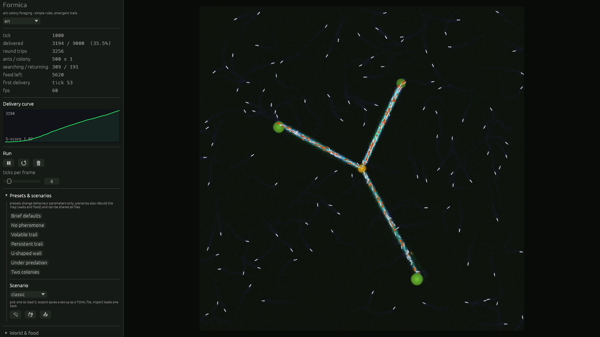
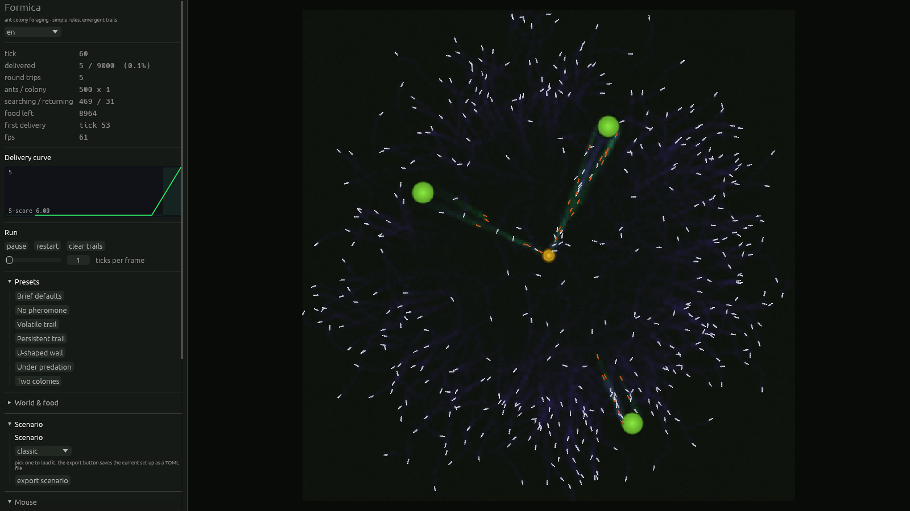

# Formica — 蚁群觅食模拟器

> **English** | [中文](README.zh-CN.md)


用 Rust + Bevy 从零实现的蚁群觅食模拟器。每只蚂蚁只有三条规则：**跟着食物气味走、随手撒下回家的气味、找到食物就掉头**。
没有任何一只蚂蚁知道食物在哪里，也没有任何全局规划——但整个蚁群会在几千 tick 内自发形成一条从巢穴到食物的稳定通路。

这个仓库的重点不是"把蚂蚁画出来"，而是**能测量**：同一套 system、同一个 schedule，既跑无渲染的命令行验收，也驱动可交互的 Bevy 窗口。



```
cargo run -p formica-headless --release -- --ticks 5000   # 命令行 + ASCII 曲线 + 参数扫描
cargo run -p formica-app     --release                    # 窗口 + 调参面板 + 鼠标改地图
```

游戏里能做的事：拖滑块实时调参、改地图尺寸、**鼠标点击放食物**、鼠标拖拽画墙、
开关捕食者、开第二窝蚂蚁竞争。命令行能跑同样的配置并给出数字。
界面与命令行输出均支持**中英文**（`FORMICA_LANG=zh` 或 `--lang zh`，窗口面板里也可随时切换）。

---

## 目录

- [验收结果](#验收结果)
- [快速开始](#快速开始)
- [i18n(中英文)](#i18n中英文)
- [机制说明](#机制说明)
- [架构](#架构)
- [参数参考](#参数参考)
- [Phase 4 扩展特性](#phase-4-扩展特性)
- [实现笔记与踩坑记录](#实现笔记与踩坑记录)
- [项目结构](#项目结构)
- [测试](#测试)
- [已知限制 / 后续](#已知限制--后续)

---

## 验收结果

### Phase 1 验收标准

> 能在 5000 tick 内看到食物总量曲线呈 S 形增长

**通过。** 默认参数（500 只蚂蚁、256×256、蒸发率 0.1、感知半径 3、随机游走 0.3、速度 2 格/tick）
完整跑满 5000 tick：

```
9000 |                                        ######################################
     |                                   ###########################################
     |                               ###############################################
     |                            ##################################################
     |                         #####################################################
     |                       #######################################################
     |                     #########################################################
     |                   ###########################################################
     |                ##############################################################
     |              ################################################################
     |            ##################################################################
     |          ####################################################################
     |        ######################################################################
     |      ########################################################################
     |    ##########################################################################
   0 |##############################################################################
     +------------------------------------------------------------------------------
      tick 0                                                            tick 5000
```

| 指标 | 数值 |
|---|---|
| 运回食物总量 | 9000.0 / 9000.0 单位（**100%** 回收） |
| 往返次数 | 9207 次 |
| 首次运回 | tick 60 |
| 10% / 50% / 90% | tick 400 / 1360 / 2630 |
| 峰值运回速率 | tick 400 |
| **S 形评分** | **3.50** |

**"S 形评分"的定义**（`formica_core::metrics::analyze`）：

```
S 评分 = 峰值区间运回量 / 平均区间运回量
```

匀速直线累积的曲线，峰值等于均值，评分 1.0；S 形曲线有滞后期、陡增期、平台期，峰值远高于均值。
本项目采用的判定阈值：`>= 2.0` 强 S、`>= 1.5` 明显 S、`>= 1.15` 弱 S、其余视为线性。

曲线形态与里程碑完全吻合 S 形：前 400 tick 只运回 10%（滞后期），400→2630 tick 运回 80%（陡增期），
2630 tick 之后几乎水平（平台期）。

### Phase 2 验收标准

> 能直观看到路径从混沌到收敛的全过程

信息素场是单张 256×256 的 `Image` 资源，每帧重写 CPU 端字节缓冲后由 Bevy 重新上传，
以一张 sprite 铺满整张地图，GPU 最近邻采样渲染。蚂蚁/巢穴/食物堆是普通颜色 sprite。

**tick 1000**（`docs/figures/phase2-converged.png`）：三条通路已经成形，从巢穴（琥珀色方块）分别通向左中、右上、
右下三个食物堆（绿色方块）。白色小点是觅食态蚂蚁，橙色小点是载着食物的归巢态蚂蚁。
紫蓝色弥散是归巢信息素，通路上的青绿色是食物信息素。


**tick 60**（`docs/figures/phase2-early.png`）：同一次运行的早期。通路还只是刚出现的细线，
大部分蚂蚁仍在图上乱走——这就是"混沌"的起点。



几张图连起来看，能直接读到正反馈在起作用。面板里的 `searching / returning` 读数：

| tick | 觅食态 / 归巢态 | 归巢占比 | 已运回 |
|---|---|---|---|
| 500 | 331 / 169 | 34% | 15.4% |
| 1500 | 362 / 138 | 28% | 55.9% |
| 3000 | 432 / 68 | 14% | 97.0% |

tick 500 前后归巢占比达到 34% 的峰值：通路一旦形成，就有更大比例的蚂蚁能找到食物并满载而归。
之后占比单调回落，是因为食物快被搬空了，没什么可运的。

### 自动截图（用于无人值守验证）

画面对不对，不能靠"看起来差不多"。窗口版支持环境变量驱动的脚本化运行，
`scripts/capture-figures.ps1` 就是用它把本文件里的每一张图重新生成一遍：

```bash
FORMICA_SCREENSHOT=docs/figures/shot.png \
FORMICA_SCREENSHOT_FRAME=90 \
FORMICA_TICKS_PER_FRAME=4 \
FORMICA_EXIT_AFTER=115 \
cargo run -p formica-app --release
```

| 环境变量 | 作用 |
|---|---|
| `FORMICA_SCREENSHOT` | 截一帧写到该路径 |
| `FORMICA_SCREENSHOT_FRAME` | 第几帧截（默认 600） |
| `FORMICA_TICKS_PER_FRAME` | 启动时的快进倍率 |
| `FORMICA_EXIT_AFTER` | 第几帧退出 |
| `FORMICA_ANTS` / `FORMICA_COLONIES` / `FORMICA_MAP_SIZE` | 覆盖蚁群规模与地图 |
| `FORMICA_INDIVIDUALITY` | 覆盖个体差异强度（`0` = 全部一样的蚂蚁） |
| `FORMICA_OBSTACLES` / `FORMICA_BLOCK_DENSITY` / `FORMICA_U_WALL_GAP` | 覆盖障碍物 |
| `FORMICA_CROWD_THRESHOLD` / `FORMICA_CROWD_RELIEF` | 覆盖拥挤缓解参数 |
| `FORMICA_SHOW_FOOD` / `FORMICA_SHOW_HOME` | 置 `0` 隐藏对应信息素 |
| `FORMICA_FOOD_GAIN` / `FORMICA_HOME_GAIN` | 覆盖显示增益 |

这套开关是用来**验证**配色断言的，不是装饰。对渲染出的 PNG 做逐像素统计（`scripts` 里没有这一步，
是临时脚本；统计范围是地图那 580×580 像素）：
`FORMICA_SHOW_HOME=0` 的那一帧里有 **2255 个绿色主导像素、0 个紫色主导像素**——
这才确认了"食物信息素是绿的"在屏幕上真的成立，而不是只在我的映射公式里成立。

### Phase 3 验收标准

> 拖动滑块能实时看到路径形态变化

所有滑块直接写进 `SimConfig` 这个 `Resource`，而**每一个仿真 system 每 tick 都重新读取它**。
所谓"热更新"不是额外实现的功能，而是数据导向设计的自然结果——面板里没有任何 Apply 按钮。

蚁群数量、蚁群窝数、墙、捕食者都是**运行时**生效的：`sync_ant_count` / `sync_nests` /
`sync_obstacles` / `sync_predator_count` 各自把世界拉回配置描述的样子。唯一需要按钮的是地图尺寸。

### Phase 4 验收标准（可选特性）

> 障碍物（U 形墙）、捕食者、双蚁群竞争

三个都实现了，**每个都有对照实验和量化结果**——详见 [Phase 4 扩展特性](docs/zh-phase4-features.md)：

| 特性 | 对照结果 |
|---|---|
| U 形墙 | 6761 → **5638**（−16.6%），且蚁群仍能找到绕行路线 |
| 捕食者（8 只） | 7887 → **2550**（−67.7%）；蚂蚁数量不缩水，代价是时间和货物 |
| 双蚁群 | 一窝 150 只 6161 → 两窝各 75 只 6104（同一巢区、四个种子的平均代价约 **3%**） |

---

## 快速开始

需要 Rust 1.95+（本项目在 1.97.1 上验证）。首次编译 Bevy 需要几分钟。

### Phase 1：无渲染命令行

```bash
# 默认参数跑 5000 tick，打印 ASCII 曲线和完整报告
cargo run -p formica-headless --release -- --ticks 5000

# 把曲线导出成 CSV（tick, delivered, colony0, colony1, searching, returning, ...）
cargo run -p formica-headless --release -- --ticks 5000 --csv docs/curve.csv

# 参数扫描：一次跑多组并对比
cargo run -p formica-headless --release -- --sweep-evaporation 0.005,0.01,0.05,0.1,0.2,0.3
cargo run -p formica-headless --release -- --sweep-random-walk 0.0,0.1,0.3,0.6,1.0
cargo run -p formica-headless --release -- --sweep-predators 0,1,2,4,8
cargo run -p formica-headless --release -- --sweep-individuality 0.0,0.2,0.4,0.6,1.0,1.5

# 单独开一个特性
cargo run -p formica-headless --release -- --obstacles u-wall --ticks 2500
cargo run -p formica-headless --release -- --predators 6 --food-per-pile 4000
cargo run -p formica-headless --release -- --colonies 2 --ants 250

# 场景:内置名或 TOML 文件;其余参数仍可叠加
cargo run -p formica-headless --release -- --scenario labyrinth
cargo run -p formica-headless --release -- --scenario my-run.toml

# 分享一套设置:把内置场景(或你在其上叠加参数后的版本)完整写成 TOML——
# 墙体、食物、几何、种子全部包含在内
cargo run -p formica-headless --release -- --scenario labyrinth --export-scenario share-labyrinth.toml

# 全部选项
cargo run -p formica-headless --release -- --help
```

命令行退出码：运回了食物 → `0`，一只都没运回 → `1`。可以直接用作 CI 检查。
### 场景

场景是一份可分享的 TOML:参数覆盖 + 显式地图(墙矩形、食物点)。它让自定义地图可复现——同一场景 + 同一种子 = 逐位相同的运行。

| 名称 | 内容 |
|---|---|
| `classic` | 任务书默认:3 堆种子食物、空地 |
| `duel` | 双蚁群、各自的信息素、共享同一食物环 |
| `labyrinth` | 45% 墙——拥挤缓解为之而生的迷宫 |
| `fortress` | 食物被 U 形墙围住、三只捕食者巡猎 |
| `arid` | 蒸发快、蚁群稀:困难模式 |
| `long-haul` | 512×512 地图、八个食物堆、一路长队 |
| `maze-run` | 手工走廊 + 远端一场固定盛宴 |

加载方式:命令行 `--scenario <名称或文件>`、窗口面板的**「场景」**区(下拉加载、带路径框的导出/导入按钮)、或脚本化运行设 `FORMICA_SCENARIO=fortress`。窗口版渲染同时做了精细化:蚂蚁按朝向旋转、蚁巢是土丘、食物是软圆盘、墙面有受光面与阴影、地面呈现土壤色调。

导出是完整的,并可原路导入:**导出预设场景**把下拉中选中的内置场景完整序列化(墙体、食物点、U 形墙几何、种子都在内),**导出当前设置**捕捉屏幕上的实时状态、手工放置的每一堆食物,**以及画笔绘制的墙——擦除过的部分也在内**:被手绘过的地图会把整张墙网格分解成显式矩形写入文件,而从未手绘过的地图仍以紧凑的预设关键字导出。**从文件导入**把任一 TOML 读回并重建世界。命令行对应 `--export-scenario <路径>`;把导入的文件再次导出,结果逐字节相同——这就是可复现性契约。
### Phase 2 + 3 + 4：可交互窗口

```bash
cargo run -p formica-app --release
```

**鼠标操作**（面板 `Mouse` 区可切换模式和开关）：

| 操作 | 效果 |
|---|---|
| 左键点击地图 | 按当前模式放食物 / 画墙 / 擦除 |
| 左键拖动 | 连续画墙（食物只在按下瞬间放一堆，否则食物量会变成帧率的函数） |
| 右键点击或拖动 | 擦除：移走鼠标下的食物堆，并清掉刷子范围内的墙 |

左侧面板：

| 分区 | 内容 |
|---|---|
| 运行状态 | tick、运回量、**分窝统计**、往返次数、觅食/归巢数量、蚂蚁被吃数、FPS |
| 运回曲线 | 实时绘制的累积曲线（**两窝时画两条**）+ S 评分 |
| Run | 暂停、restart、**清空信息素**、ticks/frame 快进 |
| Presets | 七组可复现的对比参数 |
| Scenario | **内置场景加载**,导出当前设置/所选预设为 TOML,**从文件导入** |
| World & food | **地图尺寸（拖完点 apply size）**、食物堆数量 / 总量 / 半径 |
| Mouse | 地图编辑开关、模式、刷子半径、新食物堆含多少食物 |
| Obstacles | 空地 / U 形墙 / 随机方块；U 形墙尺寸、方块密度 |
| Colonies | **蚁群数量 1–2**、两巢间距 |
| Pheromones | 蒸发率（对数滑块）、撒放强度、撒放核半径、浓度上限 |
| Ants | 每窝蚂蚁数、速度、感知半径、触角张角、采样半径、随机游走、循迹增益、归巢气味引导、**个体差异** |
| Crowding | **堵塞阈值、缓解步长**，以及实时的"最挤的 4×4 方块里有多少只蚂蚁"读数 |
| Predators | **捕食者数量**、速度、视野、捕获半径、游走强度 |
| Display | 食物/归巢信息素增益、显隐 |
| Language | **中 / 英切换**，即时生效 |

地图尺寸之所以要按一次按钮而不是即时生效：改尺寸要重新分配信息素纹理并重建整个场景，
跟着滑块每像素重建一次没法用。其余参数都是即时生效的。

### 测试

```bash
cargo test --release                                            # 全部单元 + 集成测试
cargo test -p formica-core --release -- --ignored --nocapture   # 完整 5000 tick 验收（会打印曲线）
```

---

## i18n(中英文)

界面与命令行输出都有中英两份文案，全部集中在 `formica_core::i18n` 的两张字符串表
（`EN` / `ZH`）里——没有宏、没有外部依赖，缺译会在编译期和测试里直接暴露。

| 界面 | 默认 | 切换方式 |
|---|---|---|
| 窗口面板（egui） | English | 面板顶部 Language 下拉框**即时切换**；或启动前设 `FORMICA_LANG=zh` |
| 命令行（help / 进度 / 报告 / 扫描） | English（Windows 控制台默认代码页无法渲染中文） | `--lang zh` 或 `FORMICA_LANG=zh` |

细节：

- egui 默认字体不含 CJK 字形。窗口版启动时会扫描常见系统中文字体（微软雅黑 / SimHei /
  Noto Sans CJK / PingFang），注册为 egui 的**回退字体**——英文界面外观不变，中文不再显示方块。
  字体位置特殊时可用 `FORMICA_CJK_FONT` 指定。
- 中文报告里的对齐列宽是按显示宽度设计的，在 UTF-8 终端（Windows Terminal、`chcp 65001`）下阅读最佳。
- i18n 自带 3 个测试：两张表逐字段非空、help 的旗标清单两种语言一致、
  中文表不是英文表的拷贝。新增字符串漏译会直接挂测试。

---

## 机制说明

四个"为什么"——两种信息素、为什么会收敛、为什么蚂蚁不是一模一样的、
为什么用三个触角而不是一个梯度——单独成篇：**[机制说明](docs/zh-mechanics.md)**。

一句话版本：两种信息素把"气味"变成有方向的信号（没有蚂蚁会写自己正在跟的场）；
收敛来自沉积与蒸发的正反馈平衡；个体差异（`AntVigor`）打破了对称性，
让蚁群不再扩散成一个空心圆环；三点触角采样做的是**循迹对齐**而不是梯度爬升。

---

## 架构

数据导向设计、八个蚂蚁 Component、Resource 清单、16 个 system 的 tick 调度顺序，
以及"为什么用独立 schedule"——见 **[架构](docs/zh-architecture.md)**。

核心承诺：`formica-core` 只依赖 `bevy_ecs` + `bevy_app`，不依赖渲染；
命令行版和窗口版跑**同一批 system、同一个顺序**——Phase 1 测出来的数字就是对 Phase 2 画面的预测。

版本：**Bevy 0.19.1** + **bevy_egui 0.42.0**（egui 0.36）。

---

## 参数参考

| 参数 | 默认值 | 命令行 | 说明 |
|---|---|---|---|
| `ant_count` | 500 | `--ants` | **每窝**蚂蚁数（两窝时总数翻倍） |
| `colony_count` | 1 | `--colonies` | 竞争蚁群数量，1–2 |
| `nest_orbit` | 55 | `--nest-orbit` | 两窝时巢穴到地图中心的距离 |
| `width` × `height` | 256×256 | `--width/--height` | 地图尺寸 |
| `evaporation_rate` | 0.1 | `--evaporation` | 每 tick `c *= (1 - r)` |
| `sensor_distance` | 3.0 | `--sensor-distance` | 感知半径（格） |
| `sensor_angle` | 0.6 | `--sensor-angle` | 触角半张角（弧度） |
| `sensor_box_radius` | 1 | `--sensor-box` | 触角盒平均半径 |
| `random_walk_strength` | 0.3 | `--random-walk` | 每 tick 朝向抖动 |
| `speed` | 2.0 | `--speed` | 每 tick 移动格数 |
| `deposit_amount` | 1.0 | `--deposit` | 每只蚂蚁每 tick 撒放总量 |
| `deposit_radius` | 1 | `--deposit-radius` | 撒放核半径（总量守恒） |
| `sensor_turn_gain` | 0.6 | `--turn-gain` | 朝最优触角的转向量 |
| `max_turn_rate` | 0.8 | — | 归巢时每 tick 最大转向 |
| `home_pheromone_weight` | 0.0 | — | 归巢蚂蚁跟随归巢气味的权重（0 = 任务书行为） |
| `homing_mode` | path | `--homing` | 归巢蚂蚁的导航方式:`path`(直线,任务书行为)/ `wall`(触角提前感知墙体并逃逸)/ `flow`(到巢穴的 BFS 导航场) |
| `individuality` | 0.6 | `--individuality` | **个体差异强度**（对数正态 sigma，0 = 全部一样） |
| `crowd_threshold` | 24 | `--crowd-threshold` | 每个 4×4 方块超过多少只算堵塞 |
| `crowd_relief` | 0.6 | `--crowd-relief` | 挤开时每 tick 挪多少格（0 = 关闭缓解） |
| `food_pile_count` | 3 | `--piles` | 食物堆数量（1–8） |
| `food_per_pile` | 3000 | `--food-per-pile` | 每堆食物量 |
| `food_pile_radius` | 6.0 | `--pile-radius` | 堆半径（格） |
| `ant_capacity` | 1.0 | — | 单只蚂蚁载重 |
| `obstacle_preset` | None | `--obstacles` | `none` / `u-wall` / `blocks` |
| `predator_count` | 0 | `--predators` | 捕食者数量，0 = 关闭 |
| `predator_speed` | 1.6 | `--predator-speed` | 捕食者速度（格/tick） |
| `predator_sense` | 26 | `--predator-sense` | 捕食者视野半径（格） |
| `predator_catch_radius` | 3 | `--predator-catch` | 捕获半径（格） |
| `max_pheromone` | 50.0 | — | 单格浓度上限 |
| `seed` | 20240517 | `--seed` | 随机种子（同种子 = 逐位相同的运行） |

---

## Phase 4 扩展特性

障碍物（U 形墙）、捕食者、双蚁群竞争三个特性，每个都有对照实验与量化结果——
完整数据与截图见 **[Phase 4 扩展特性](docs/zh-phase4-features.md)**。

| 特性 | 结论 |
|---|---|
| U 形墙 | 产量 −16.6%，但蚁群仍能找到绕行路线——错误路径被蒸发淘汰的直接演示 |
| 捕食者 | 8 只把产量压到 28.3%；损失的是时间和货物，不是命（巢内免疫） |
| 双蚁群 | 同一巢区四个种子平均亏约 **3%**——"分家"的代价是气味预算劈半 |
| 三者全开 | 互不冲突，可同屏运行（`docs/figures/p4-everything.png`） |

---

## 实现笔记与踩坑记录

项目跑通之后的三处观感优化（圆环、食物堆残留、迷宫聚集），以及实验过程中
被数据推翻的假设、两个"通过了但什么都没证明"的测试、f32 记账精度问题——
这些"经过和踩坑"单独拆成了两份文档：

- **[三处观感优化](docs/zh-fixes-notes.md)**：每一条都是先复现、再量化、最后才动代码，
  并给出了修复前后的对照数字和截图。
- **[实验与发现](docs/zh-experiments.md)**：信息素对照实验、蒸发率 / 随机游走 / 个体差异扫描、
  守恒不变量抓出的两个真实 bug、显示增益那次被像素统计推翻的"优化"、
  以及"一个在错误的时刻测量的测试"。

---

## 项目结构

```
Formica/
├── Cargo.toml                      # workspace
├── crates/
│   ├── formica-core/               # 纯逻辑，只依赖 bevy_ecs + bevy_app
│   │   ├── src/
│   │   │   ├── lib.rs              # 模块地图 + prelude + 文档示例
│   │   │   ├── config.rs           # SimConfig + ObstaclePreset│   │   │   ├── scenario.rs         # Scenario:可分享的 TOML 运行(参数覆盖 + 自定义地图)│   │   │   ├── grid.rs             # PheromoneGrid：每窝两场 + 蒸发/采样/撒放（可屏蔽墙）
│   │   │   ├── world.rs            # Nests、Nest、FoodField（可增删食物堆）、FoodPile
│   │   │   ├── obstacles.rs        # Obstacles：墙 + U 形墙/随机方块预设 + 同步 system
│   │   │   ├── crowd.rs            # CrowdGrid：4×4 粗粒度密度网格 + 最空邻格方向
│   │   │   ├── motion.rs           # 边界反射 + 绕墙滑行 + 被困脱出（蚂蚁和捕食者共用）
│   │   │   ├── predator.rs         # 捕食者 Component + 生成
│   │   │   ├── ant.rs              # 八个蚂蚁 Component + AntVigor 个体差异 + 状态机
│   │   │   ├── rng.rs              # SplitMix64 + Box-Muller 正态（确定性、零依赖）
│   │   │   ├── metrics.rs          # SimStats（分窝账目 + 浓度读数）+ 曲线分析 + ASCII 图
│   │   │   ├── i18n.rs             # 中英文字符串表（EN/ZH）+ Lang
│   │   │   ├── plugin.rs           # SimPlugin、SimulationTick schedule、初始化/重置
│   │   │   └── systems/            # 一阶段一文件
│   │   │       ├── sense.rs  decide.rs  movement.rs  deposit.rs  evaporate.rs
│   │   │       ├── crowd.rs  interact.rs  spawn.rs  stats.rs  predator.rs  obstacles.rs  flow.rs
│   │   ├── tests/
│   │   │   ├── phase1_acceptance.rs  # 验收 + 守恒不变量 + 信息素对照实验
│   │   │   ├── phase4_features.rs    # 障碍物/捕食者/双蚁群 + 地图缩放 + 玩家放食物
│   │   │   └── emergence_shape.rs    # 三处观感优化的回归测试（圆环 / 迷宫聚集 / 缓解无害）
│   ├── formica-headless/           # 命令行，零渲染
│   │   └── src/main.rs             # 参数解析、ASCII 曲线、CSV、分窝报告、参数扫描
│   └── formica-app/                # Bevy 窗口
│       └── src/
│           ├── main.rs             # 插件装配 + SimulationTick 驱动 + 脚本化截图
│           ├── lang.rs             # 面板语言资源 + CJK 回退字体注册
│           ├── paint.rs            # 浓度/墙 → 像素（纯函数，可单测）
│           ├── render.rs           # 相机、世界纹理、sprite 同步、食物堆缩放、尺寸变化重建
│           ├── interact.rs         # 鼠标 → 放食物 / 画墙 / 擦除
│           └── ui.rs               # egui 面板 + 手绘曲线 + 预设
├── scripts/
│   ├── capture-figures.ps1         # 重新生成 docs/ 里的每一张图
│   └── measure-readme.ps1          # 重新测量 README 里引用的每一个数字
└── docs/
    ├── phase1-default.csv          # 默认参数 5000 tick 的完整曲线
    ├── zh-*.md                     # 从 README 拆出的实现笔记 / 踩坑 / 架构 / 机制 / Phase 4
    └── figures/*.png               # 各特性的运行截图
```

---

## 测试

```
cargo test --release
```

全部单元 + 集成测试（另有 1 个 `#[ignore]` 的完整 5000 tick 验收，用 `-- --ignored` 跑），
覆盖网格语义、蚂蚁行为、个体差异、拥挤、移动与墙、障碍物、捕食者、双蚁群、食物系统、
食物渲染、归巢导航方式、地图缩放、统计、调度、集成不变量、形状回归、渲染、交互与 i18n。

测试设计的完整说明（守恒律、对照实验即测试、行翻转、幻影食物堆回归、
"测位移而不是产量"、"对照组自检"）见 **[实验与发现](docs/zh-experiments.md)**。

---

## 已知限制 / 后续

- **最多两窝**：`MAX_COLONIES = 2`。数据结构本身没有这个上限，扩到 3 或 4 只是每窝多 512 KiB 场和一个颜色。
- **两窝的公平性依赖种子**：巢穴到地图中心等距，但食物是按种子随机撒在环上的，单个种子上不会完全对称。
- **个体差异是单轴的**：每只蚂蚁只有一个"胆量"值，同时决定游走强度和速度。
- **拥挤缓解只治"挤"，不治"堵"**：45% 墙密度下地形本身不渗流，蚂蚁出不去——这是地图的问题，不是规则的问题。
- **蚂蚁没有个体记忆**：`AntVigor` 是生成时抽定的固定性格，不是"我来过这里"的记忆，也不是学习。
- **归巢是直线朝向**：符合任务书要求；`home_pheromone_weight` 已预留跟随归巢气味的开关。对于蚂蚁与巢穴之间有墙的情形,`--homing wall`(触角避墙 + 卡死逃逸)与 `--homing flow`(BFS 巢穴导航场)是可选方案;默认保持任务书行为不变(1500 tick 单缺口墙地图实测:直线 344 单位、避墙 452、导航场 2020)。
- **捕食者不吃蚁后/不消耗自己**：捕食压力是恒定的。
- **U 形墙只围第一个食物堆**：为了让实验可复现。
- **地图尺寸不能连续拖**：拖完要点 apply size，因为要重分配纹理并重建场景。
